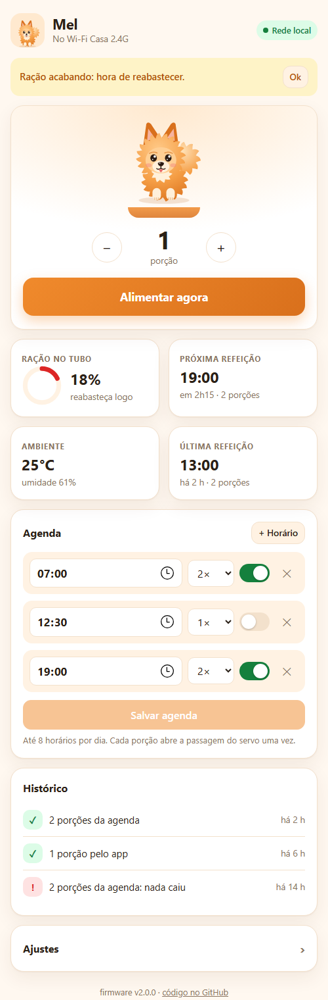
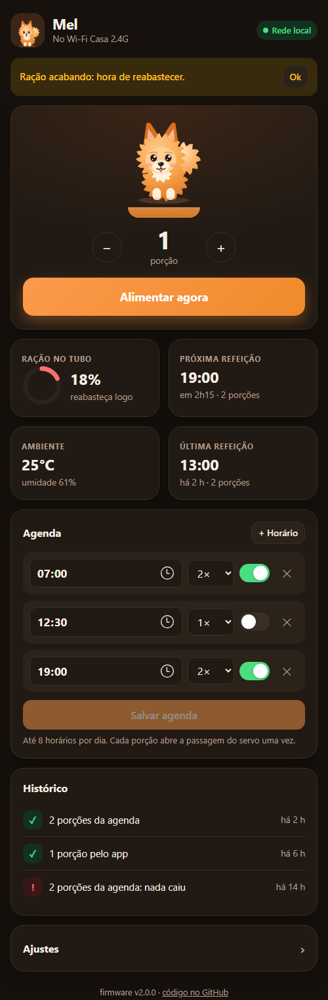
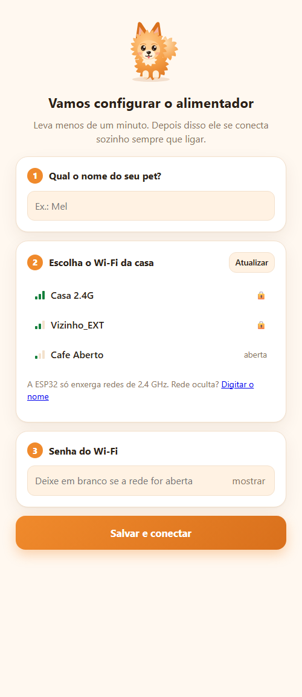
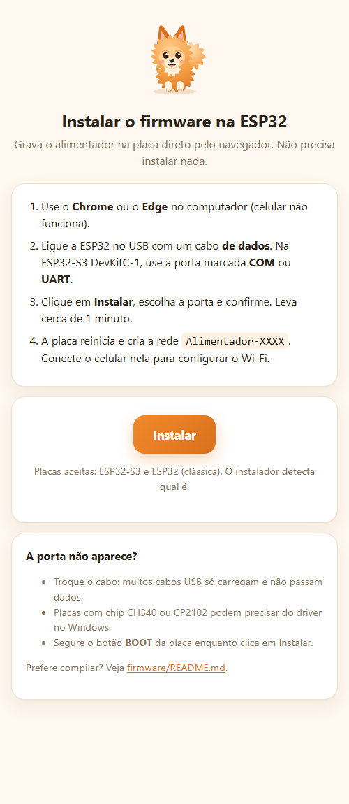
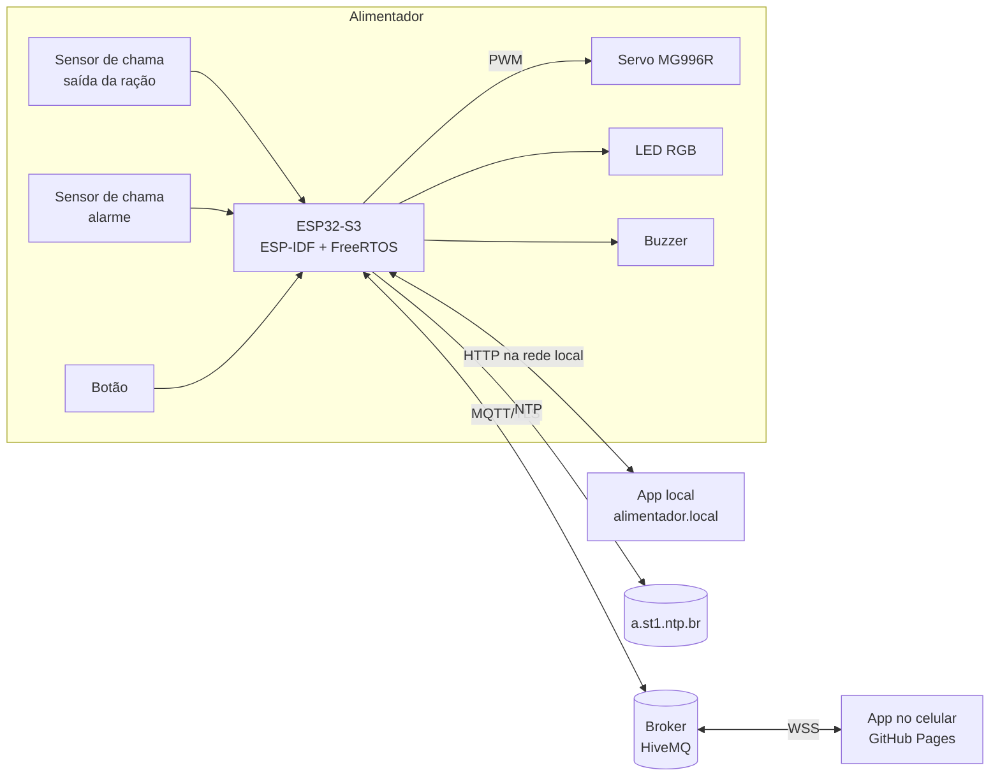

<p align="center">
  
</p>

<h1 align="center">Lulu · Alimentador Automático de Pets</h1>

<p align="center">
  Alimentador de ração com <a href="https://www.espressif.com/en/products/socs/esp32-s3">ESP32-S3</a>: agenda de refeições, nível de ração, alerta quando a ração não cai<br>
  e controle pelo celular de qualquer lugar. Firmware em <a href="https://docs.espressif.com/projects/esp-idf/en/v5.3/esp32s3/index.html">ESP-IDF</a> + <a href="https://www.freertos.org/">FreeRTOS</a>, peças impressas em 3D e tubo de PVC.
</p>

<p align="center">
  <a href="https://arthurlleite.github.io/lulu-alimentador/"><b>Abrir o app</b></a> ·
  <a href="https://arthurlleite.github.io/lulu-alimentador/instalar.html"><b>Instalar na ESP32</b></a> ·
  <a href="documentacao/materiais.md"><b>Lista de compras</b></a> ·
  <a href="documentacao/montagem.md"><b>Montagem</b></a>
</p>

<p align="center">
  <a href="https://github.com/arthurlleite/lulu-alimentador/actions/workflows/site.yml"></a>
  
  
  
</p>

---

## Sumário

- [O que ele faz](#o-que-ele-faz)
- [Como ficou o app](#como-ficou-o-app)
- [Como funciona](#como-funciona)
- [Produto de referência](#produto-de-referência)
- [O que comprar](#o-que-comprar)
- [Peças 3D](#peças-3d)
- [Organização das pastas](#organização-das-pastas)
- [Como começar](#como-começar)
- [História do projeto](#história-do-projeto)
- [Disciplina e equipe](#disciplina-e-equipe)

## O que ele faz

- **Agenda**: até 8 refeições por dia, cada uma com sua quantidade de porções, ligando e desligando cada horário.
- **Alimentar agora**: pelo app, de casa ou de qualquer lugar, ou apertando o botão do aparelho.
- **Confere se a ração caiu**: um sensor infravermelho (módulo de sensor de chama) na saída conta os grãos que passam. Se nada saiu (tubo vazio ou travado), o alimentador sacode, tenta de novo e avisa.
- **Alarme de fogo**: um segundo sensor de chama, virado para fora, faz o LED piscar vermelho, toca o buzzer e avisa no app.
- **Configuração pelo celular**: na primeira vez, ele cria a rede `Alimentador-XXXX`; ao conectar, abre uma página para escolher o Wi-Fi e dar o nome do pet. Não precisa mexer em código.
- **Funciona sem internet**: o app também fica na própria ESP32, em `http://alimentador.local`.
- **LED de status, bip e histórico** das últimas refeições.

## Como ficou o app

| App na rede local | Modo escuro | Configuração do Wi-Fi | Instalador |
|:---:|:---:|:---:|:---:|
|  |  |  |  |

O mesmo app roda em dois lugares:

| Onde | Endereço | Como fala com o alimentador |
|---|---|---|
| **Pela internet** | [arthurlleite.github.io/lulu-alimentador](https://arthurlleite.github.io/lulu-alimentador/) + código do aparelho | [MQTT](https://mqtt.org/) com TLS pelo [broker público da HiveMQ](https://www.hivemq.com/mqtt/public-mqtt-broker/) |
| **Na rede de casa** | `http://alimentador.local` | HTTP direto na ESP32 (funciona sem internet) |

## Como funciona

<p align="center"></p>

A ração fica num **tubo de PVC** apoiada numa **rampa inclinada** com um furo. Embaixo da rampa, um **servo** gira uma tampa que abre e fecha esse furo: cada abertura é uma porção. A ração cai num **funil** e sai pela lateral, direto no pote.



<p align="center"><a href="hardware/eletronica/README.md"></a></p>

Detalhes: [firmware](firmware/README.md) · [esquemático e ligações](hardware/eletronica/README.md) · [peças 3D](hardware/3d/README.md) · [hospedagem e segurança](documentacao/hospedagem.md).

## Produto de referência

O projeto toma como base o **[PETLIBRO Air Smart Feeder (PLAF108)](https://au.petlibro.com/products/air-wifi-feeder)**, um alimentador comercial que usa um chip da própria Espressif por dentro ([ESP32-C3-WROOM-02](https://www.espressif.com/sites/default/files/documentation/esp32-c3-wroom-02_datasheet_en.pdf), segundo o [teardown da Pinecone Data](https://www.pineconedata.com/2026-06-19-flashing-esphome-on-wifi-pet-feeder/)) e tem firmware aberto feito pela comunidade ([petlibro-esphome](https://github.com/taylorfinnell/petlibro-esphome)), o que permite saber o que cada pino faz.

| Função | PETLIBRO Air | Lulu |
|---|---|---|
| Microcontrolador | ESP32-C3 (RISC-V, 1 núcleo) | ESP32-S3 (Xtensa LX7, 2 núcleos) |
| Refeições por dia | até 10 | até 8 |
| Dosagem | motor DC + rotor | servo MG996R + tampa giratória |
| Confere a saída da ração | sensor IR | sensor IR (módulo de chama) |
| Nível de ração | alerta de ração baixa | não tem (pelo app, quando a ração não cai) |
| Alarme de fogo | não tem | sensor de chama |
| Bateria de reserva | 5200 mAh | não (próximo passo) |
| App | app do fabricante | app web próprio, local e pela internet |

Comparação completa, pinos do PETLIBRO e outros produtos do mercado: **[documentacao/referencia-comercial.md](documentacao/referencia-comercial.md)**.

## O que comprar

Lista completa, com a origem de cada peça: **[documentacao/materiais.md](documentacao/materiais.md)**.

### Eletrônica (já comprada)

A eletrônica está fechada e segue o [esquemático](hardware/eletronica/README.md). Parte já estava com a equipe; o resto foi comprado em 26/10/2026 e dividido entre os quatro integrantes.

| Peça | Para que serve | Origem |
|---|---|---|
| **ESP32-S3-DevKitC-1 N16R8** | cérebro do alimentador: Wi-Fi 2,4 GHz, Bluetooth 5, 2 núcleos de 240 MHz | acervo |
| **Servo MG996R 180°** | abre e fecha a passagem da ração (o suporte 3D foi feito para ele) | acervo |
| **Fonte 5 V / 5 A** + conector P4 com borne | alimenta a ESP32 e o servo | acervo |
| Resistores 220 Ω, placa perfurada 7×9 cm, barras de pinos, jumpers, fio 20 AWG | montagem | acervo |
| **2 módulos sensor de chama** | um confirma que a ração caiu, o outro é alarme de fogo | R$ 17,99 |
| **LED RGB catodo comum** | status | R$ 22,48 (10 un.) |
| **Buzzer ativo 3,3 V** | chama o pet e avisa erro | R$ 18,90 (5 un.) |
| **Chave táctil 12×12 mm** | alimentar na hora e apagar o Wi-Fi | R$ 19,99 |
| **Capacitor 1000 µF / 16 V** | segura o pico do servo | R$ 20,00 (20 un.) |
| **Total do rateio** | | **R$ 99,36** (R$ 24,84 por integrante) |

### Estrutura

| Peça | Para que serve | Preço cotado | Onde |
|---|---|---|---|
| **Tubo PVC esgoto 100 mm** (barra de 1 m) | reservatório (usa 300 mm) | R$ 17 – 25 | [Hidrauconex](https://www.hidrauconex.com/tubo-cano-pvc-esgoto-branco-de-100mm-barra-6-metros) (barra de 6 m por R$ 98,10, ~R$ 16/m), [Mercado Livre](https://lista.mercadolivre.com.br/tubo-pvc-100-mm-esgoto) |
| **Cap PVC esgoto 100 mm** | fecha a base | R$ 12 – 25 | [Hidrauconex](https://www.hidrauconex.com/cap-tampao-pvc-esgoto-de-100mm) (R$ 14,10) |
| **Filamento PETG** (~150 g) | peças impressas | R$ 15 – 25* | — |
| Parafusos, cola epóxi, tinta (opcional) | fixação e acabamento | R$ 20 – 50* | — |

\* estimado (sem preço publicado nas buscas).

**Total a comprar: R$ 120 – 240** (ESP32-S3, servo e fonte já estão com a equipe).

## Peças 3D

Modeladas no [FreeCAD](https://www.freecad.org/), prontas para fatiar em [`hardware/3d/stl`](hardware/3d/stl).

| | | | |
|:---:|:---:|:---:|:---:|
| <br>[Rampa inclinada](hardware/3d/stl/rampa_inclinada.stl) | <br>[Tampa do atuador](hardware/3d/stl/tampa_atuador.stl) | <br>[Suporte do motor](hardware/3d/stl/suporte_motor.stl) | <br>[Funil interno](hardware/3d/stl/funil_interno.stl) |
| <br>[Extensão do funil](hardware/3d/stl/extensao_funil.stl) | <br>[Tampa do tubo](hardware/3d/stl/tampa_tubo.stl) | <br>[Suporte da rampa](hardware/3d/stl/suporte_rampa.stl) | <br>[Suporte da placa](hardware/3d/stl/suporte_placa.stl) |

Medidas, volume e configuração de impressão: [hardware/3d/README.md](hardware/3d/README.md).

## Organização das pastas

```
lulu-alimentador/
├── firmware/              → o que vai na ESP32 (PlatformIO + ESP-IDF)
│   ├── src/               → código C (dosador, agenda, sensores, rede...)
│   ├── platformio.ini     → placas ESP32-S3 e ESP32
│   └── partitions.csv     → mapa da memória flash
├── web/                   → app do celular (vai para o GitHub Pages e para dentro da ESP32)
│   ├── index.html         → painel do pet
│   ├── configurar.html    → configuração do Wi-Fi (portal)
│   └── instalar.html      → gravar o firmware pelo navegador
├── hardware/
│   ├── 3d/                → o que vai para a impressora 3D
│   │   ├── IoT3D.FCStd    → modelo original no FreeCAD
│   │   ├── stl/           → peças prontas para fatiar
│   │   └── imagens/       → renders das peças
│   └── eletronica/        → esquemático, ligações e pinos
├── documentacao/          → compras, montagem, referência comercial, hospedagem
└── ferramentas/           → scripts (arte do Lulu, exportação do 3D)
```

## Como começar

1. **Compre** os itens da [lista de materiais](documentacao/materiais.md).
2. **Imprima** as peças de [`hardware/3d/stl`](hardware/3d/stl).
3. **Grave o firmware** pelo [instalador no navegador](https://arthurlleite.github.io/lulu-alimentador/instalar.html) (Chrome ou Edge), ou compile pelo [PlatformIO](firmware/README.md#compilar-e-gravar).
4. **Ligue os fios** seguindo o [guia de eletrônica](hardware/eletronica/README.md).
5. **Monte** com o [passo a passo](documentacao/montagem.md).
6. **Configure**: conecte o celular na rede `Alimentador-XXXX`, escolha o Wi-Fi e dê o nome do pet. Pronto.

## História do projeto

- **2024 – primeira versão** ([`ped_feeder`](https://github.com/arthurlleite/lulu-alimentador/tree/8264bf7)): ESP32 com ESP-IDF 4, página em Bootstrap no [Firebase](https://firebase.google.com/), MQTT no `test.mosquitto.org` e peças no FreeCAD. Um amigo montou o protótipo a partir desse repositório e gravou a [montagem em vídeo](https://www.youtube.com/watch?v=HcdWtQP4j1U).
- **2026 – versão 2 (Lulu)**: firmware revisado e migrado para ESP-IDF 5 (vários bugs do original corrigidos, ver a [revisão do código](firmware/README.md#revisão-do-código-original)), sensores de nível, ambiente e saída, portal de configuração do Wi-Fi, MQTT com TLS e código secreto, app novo com modo local, instalador pelo navegador, peças exportadas em STL e documentação completa.

### Próximos passos

- Bateria de reserva (TP4056 + 18650 + conversor para 5 V), como no PETLIBRO.
- Atualização do firmware pela internet (OTA).
- Broker com usuário e senha ([HiveMQ Cloud](https://www.hivemq.com/products/mqtt-cloud-broker/), plano gratuito).
- Suporte da rampa integrado à peça e furos dos sensores já no modelo 3D.

## Disciplina e equipe

Projeto da disciplina **Fundamentos de Sistemas Embarcados (FSE)** — [Trabalho 2 (2026/2)](https://gitlab.com/fse_fga/trabalhos-2026_2/trabalho-2-2026-2) e Trabalho Final. Os sensores usados estão na [lista de sensores da disciplina](https://gitlab.com/fse_fga/trabalhos-2026_2/trabalho-2-2026-2/-/blob/main/Lista_de_Sensores.md).

| Nome | Matrícula |
|---|---|
| Arthur Carvalho ([@arthurlleite](https://github.com/arthurlleite)) | _a preencher_ |
| _a preencher_ | _a preencher_ |
| _a preencher_ | _a preencher_ |
| _a preencher_ | _a preencher_ |
