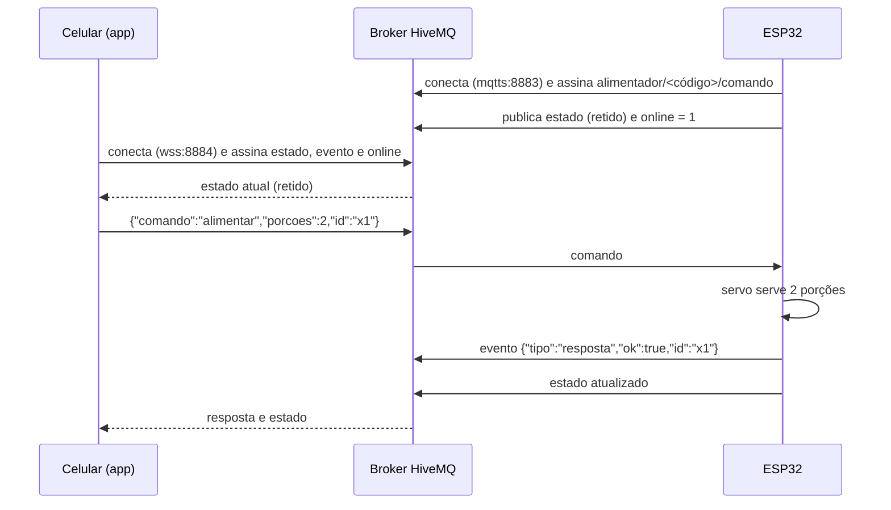

# Hospedagem e serviços (tudo gratuito)

| Parte | Onde roda | Custo | Por quê |
|---|---|---|---|
| App web e instalador | [GitHub Pages](https://pages.github.com/) | grátis | já está no mesmo repositório; HTTPS automático; publicado pelo [GitHub Actions](../.github/workflows/site.yml) a cada push |
| Firmware compilado | [GitHub Actions](https://docs.github.com/pt/actions) | grátis (repositório público) | compila as duas placas e gera os `.bin` do instalador |
| Mensagens app ↔ ESP32 | [broker MQTT público da HiveMQ](https://www.hivemq.com/mqtt/public-mqtt-broker/) | grátis | aceita TLS na porta 8883 (ESP32) e WebSocket seguro na 8884 (navegador) |
| Relógio | [NTP.br](https://ntp.br/) (`a.st1.ntp.br`) e [pool.ntp.org](https://www.ntppool.org/) | grátis | hora certa para a agenda |
| App na rede local | a própria ESP32 | — | funciona mesmo sem internet, em `http://alimentador.local` |

O projeto original usava o [Firebase Hosting](https://firebase.google.com/docs/hosting) só para servir a página; o GitHub Pages faz o mesmo sem precisar de outra conta.

## Endereços

- App: **https://arthurlleite.github.io/lulu-alimentador/** (abra com `?d=CODIGO`, o link aparece ao configurar o Wi-Fi)
- Instalador: **https://arthurlleite.github.io/lulu-alimentador/instalar.html**

## Como o app fala com o alimentador

## Segurança

- O tópico usa um **identificador aleatório de 64 bits** gerado na primeira inicialização. Esse identificador não implementa autenticação ou autorização: tópicos podem ser descobertos por clientes com acesso às assinaturas correspondentes no broker público.
- A ESP32 fala com o broker por **TLS**, e o app por **WSS** (WebSocket com TLS).
- Comandos perigosos (`esquecer_wifi`, `acertar_hora`) só funcionam pela rede local.
- O broker público **não tem senha**: conhecer o tópico permite enviar comandos. Para acesso remoto com controle de permissão, implementar autenticação e regras de publicação/assinatura por dispositivo. TLS protege o transporte; não substitui essas regras.

O firmware também precisa tratar comandos repetidos e retidos antes de ser usado de forma autônoma. Essas melhorias estão registradas no [plano de validação e limitações](../petlibro-air/proposta.md).

### Para ir além (opcional)

Crie uma conta gratuita no [HiveMQ Cloud](https://www.hivemq.com/products/mqtt-cloud-broker/) (plano Serverless), que tem usuário e senha. Depois:

1. no `menuconfig`, troque `ALIM_MQTT_URI` pelo endereço do seu cluster;
2. no [`web/index.html`](../web/index.html), troque `CONFIG.broker`;
3. acrescente usuário e senha nas duas pontas.

## Ativar o GitHub Pages (uma vez só)

Em **Settings → Pages → Build and deployment**, escolha **Source: GitHub Actions**. A partir daí, cada push na `main` recompila e publica.

