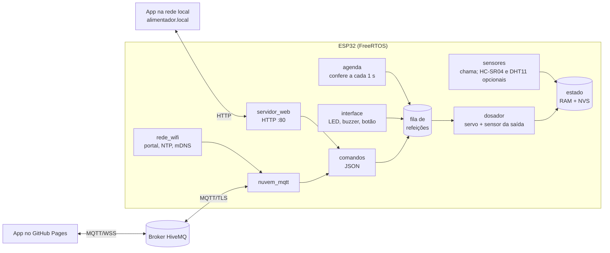

# Firmware (ESP32 + ESP-IDF)

Código que roda na ESP32. Escrito em C sobre o [ESP-IDF 5.3](https://docs.espressif.com/projects/esp-idf/en/v5.3/esp32s3/index.html) ([FreeRTOS](https://www.freertos.org/)), compilado com [PlatformIO](https://platformio.org/).

| Placa | Ambiente | Status |
|---|---|---|
| [ESP32-S3-DevKitC-1](https://docs.espressif.com/projects/esp-dev-kits/en/latest/esp32s3/esp32-s3-devkitc-1/index.html) (N16R8 ou N8R2), recomendada | `esp32s3` | compila |
| ESP32 clássica (DevKit V1 / [ESP32-WROOM-32](https://www.espressif.com/sites/default/files/documentation/esp32-wroom-32e_esp32-wroom-32ue_datasheet_en.pdf)) | `esp32` | compila |

## Jeito mais fácil: instalar pelo navegador

Abra **[arthurlleite.github.io/lulu-alimentador/instalar.html](https://arthurlleite.github.io/lulu-alimentador/instalar.html)** no Chrome ou no Edge, ligue a placa no USB e clique em **Instalar**. Os binários são gerados pelo [GitHub Actions](../.github/workflows/site.yml) a cada push, usando o [ESP Web Tools](https://esphome.github.io/esp-web-tools/).

## Compilar e gravar

1. Instale o [VS Code](https://code.visualstudio.com/) e a extensão [PlatformIO IDE](https://marketplace.visualstudio.com/items?itemName=platformio.platformio-ide).
2. Abra **a pasta `firmware/`** no VS Code (não a raiz do repositório).
3. Na barra do PlatformIO, escolha o ambiente (`esp32s3` ou `esp32`) e clique em **Upload**.
4. Abra o **Monitor** (115200 baud) para ver o log.

Pela linha de comando:

```bash
cd firmware
pio run -e esp32s3                 # compila
pio run -e esp32s3 -t upload       # grava
pio device monitor                 # log serial
pio run -e esp32s3 -t menuconfig   # pinos, broker, fuso horário...
```

> A primeira compilação baixa o ESP-IDF e os compiladores (~1,5 GB) e leva alguns minutos.

## Primeiro uso

1. Ligue a placa: o LED pisca **azul** e aparece a rede Wi-Fi **`Alimentador-XXXX`**.
2. Conecte o celular nela. A página de configuração abre sozinha (se não abrir, acesse `http://192.168.4.1`).
3. Informe o nome do pet, escolha o Wi-Fi da casa (2,4 GHz) e a senha.
4. A placa reinicia e conecta. A página mostra o **link pessoal** para controlar de qualquer lugar. Guarde esse link.
5. LED **verde** = online. Na mesma rede, o app também abre em **http://alimentador.local**.

Para trocar de Wi-Fi: segure o botão por **5 segundos** (ou o BOOT da placa), ou use **Ajustes → Esquecer Wi-Fi** no app local.

## Pinos

| Função | ESP32-S3 | ESP32 clássica | Opção no menuconfig |
|---|---|---|---|
| Servo (sinal) | GPIO 4 | GPIO 18 | `ALIM_GPIO_SERVO` |
| Sensor de chama da saída (D0) | GPIO 9 | GPIO 32 | `ALIM_GPIO_SAIDA` |
| Sensor de chama do alarme (D0) | GPIO 10 | GPIO 33 | `ALIM_GPIO_CHAMA` |
| Botão (para GND) | GPIO 15 | GPIO 27 | `ALIM_GPIO_BOTAO` |
| Buzzer ativo | GPIO 16 | GPIO 26 | `ALIM_GPIO_BUZZER` |
| LED RGB R / G / B (220 Ω cada) | GPIO 17 / 18 / 8 | GPIO 21 / 22 / 23 | `ALIM_GPIO_LED_R/G/B` |

O HC-SR04 (nível) e o DHT11 (temperatura e umidade) não fazem parte das peças da equipe e vêm **desligados** (`ALIM_SENSOR_NIVEL` e `ALIM_DHT11`). O código continua no firmware: ao ligar as opções, os pinos padrão são TRIG 5, ECHO 6 (com divisor 1 kΩ / 2 kΩ) e DHT 7 na S3. Com eles desligados, o app esconde os cartões de nível e de ambiente.

Também ficam no `menuconfig` (menus **Alimentador - ...**): ângulos e tempos do servo, calibração, broker MQTT, fuso horário e nome na rede. O esquema completo está em [`hardware/eletronica`](../hardware/eletronica/README.md).

## LED de status

| Cor | Significado |
|---|---|
| azul piscando | rede de configuração ativa (sem Wi-Fi salvo, ou não conseguiu conectar) |
| amarelo piscando | conectando ao Wi-Fi |
| ciano | Wi-Fi ok, sem conexão com a nuvem (MQTT) |
| verde | online |
| magenta | servindo ração |
| piscada vermelha | alarme: ração baixa ou o servo girou e nada caiu |
| vermelho piscando rápido + bipes | chama detectada |

## Arquitetura



| Arquivo | O que faz |
|---|---|
| [`main.c`](src/main.c) | inicia os módulos |
| [`estado.c/h`](src/estado.c) | estado global protegido por mutex, NVS (configuração e Wi-Fi), JSON de status |
| [`dosador.c/h`](src/dosador.c) | fila de refeições, servo por PWM (LEDC 14 bits, 50 Hz), sensor da saída com interrupção |
| [`agenda.c/h`](src/agenda.c) | até 8 horários por dia, cada um com sua porção |
| [`sensores.c/h`](src/sensores.c) | alarme de chama (tarefa própria, 100 ms) e, se ligados, HC-SR04 (mediana de 5 leituras) e DHT11 (protocolo de um fio) |
| [`interface.c/h`](src/interface.c) | LED RGB, buzzer e botão |
| [`comandos.c/h`](src/comandos.c) | comandos JSON, iguais pelo MQTT e pelo HTTP |
| [`rede_wifi.c/h`](src/rede_wifi.c) | Wi-Fi, portal de configuração, reconexão, SNTP e mDNS |
| [`dns_portal.c/h`](src/dns_portal.c) | DNS do portal cativo (responde tudo com 192.168.4.1) |
| [`servidor_web.c/h`](src/servidor_web.c) | servidor HTTP com o app embutido e a API local |
| [`nuvem_mqtt.c/h`](src/nuvem_mqtt.c) | cliente MQTT com TLS, tópicos e testamento online/offline |
| [`Kconfig.projbuild`](src/Kconfig.projbuild) | opções do `menuconfig` |
| [`partitions.csv`](partitions.csv) | app único de 1,875 MB (TLS + Wi-Fi + HTTP + MQTT passam de 1 MB) |

### Tarefas do FreeRTOS

| Tarefa | Prioridade | Pilha |
|---|---|---|
| dosador | 6 | 4 KB |
| agenda | 5 | 3 KB |
| interface | 4 | 3 KB |
| sensores | 3 | 3 KB |
| dns (só com o portal aberto) | 3 | 3 KB |

## Protocolo

O app manda o mesmo JSON pelo MQTT (`alimentador/<código>/comando`) ou por `POST /api/comando`:

```json
{"comando":"alimentar","porcoes":2}
{"comando":"agenda","refeicoes":[{"h":7,"m":30,"p":2,"ativa":true},{"h":19,"m":0,"p":2,"ativa":true}]}
{"comando":"ajustes","nome":"Mel","bip":true,"nivel_vazio_cm":30,"nivel_cheio_cm":4}
{"comando":"status"}
{"comando":"limpar_alarme"}
{"comando":"acertar_hora","unix":1767225600}
{"comando":"esquecer_wifi"}
```

`acertar_hora` e `esquecer_wifi` só valem pela rede local.

| Tópico MQTT | Direção | Conteúdo |
|---|---|---|
| `alimentador/<código>/comando` | app → ESP | comandos acima (com `id` opcional) |
| `alimentador/<código>/estado` | ESP → app | estado completo (retido) |
| `alimentador/<código>/evento` | ESP → app | `resposta`, `alimentado`, `racao_baixa` |
| `alimentador/<código>/online` | ESP → app | `1` ou `0` (retido, testamento) |

API local: `GET /api/estado`, `POST /api/comando`, `GET /api/redes`, `POST /api/configurar`.

## Revisão do código original

O firmware antigo (`lib/my_*`, ainda no [histórico do git](https://github.com/arthurlleite/lulu-alimentador/tree/8264bf7/lib)) tinha a arquitetura certa, mas não rodaria de forma confiável. O que foi encontrado e corrigido:

| Problema no original | Efeito | Correção |
|---|---|---|
| Não compila no ESP-IDF 5 (`.uri` do MQTT, `sntp_*` antigos, `mdns` fora do núcleo) | não gera binário nas versões atuais | APIs do IDF 5.3 e [`espressif/mdns`](https://components.espressif.com/components/espressif/mdns) pelo gerenciador de componentes |
| `xQueueFeed` criada com itens de `40*sizeof(int)` e lida para um `int` | cada refeição escrevia 160 bytes numa variável de 4 bytes (pilha corrompida) | fila com `struct` do tamanho certo |
| Ponteiro `event->data` do MQTT enviado para outra tarefa | o buffer é reaproveitado pelo cliente e não termina em `\0` | comando tratado na hora, com tamanho explícito |
| `cJSON_GetObjectItem(...)->valuestring` sem checar nulo | JSON inválido ou campo faltando travava a placa | validação de cada campo |
| `msg = malloc(200)` em todo comando, nunca liberado em alguns caminhos | vazamento de memória | respostas montadas com cJSON e liberadas |
| Agenda vazia → espera negativa; `free()` no ponteiro de `localtime` | refeição disparada errado; corrupção de heap | checagem por minuto, sem cálculo de espera |
| `nvs_flash_init()` chamado em 4 tarefas ao mesmo tempo | condição de corrida na inicialização | uma inicialização em `estado_iniciar()` |
| Tarefas com prioridade 0 (igual à tarefa ociosa), pilha de 1 KB no servo | travamentos e estouro de pilha | prioridades 3 a 6 e pilhas de 3 a 4 KB |
| Senha do Wi-Fi impressa na serial; formulário sem limite com `strcpy` em 30 bytes | vazamento da senha; estouro de buffer | log sem senha, `strlcpy` e limite de tamanho |
| Portal de configuração só por 10 min e depois reinício | sem Wi-Fi, ficava reiniciando | portal fica ativo até configurar; reconexão com espera crescente |
| Tópico fixo `exemploMQTT123456` em broker público, sem TLS | qualquer pessoa podia alimentar o pet | código aleatório de 64 bits por placa e MQTT sobre TLS |
| Servo no GPIO 5 (pino de *strapping*) | pode mexer o servo no boot | GPIO 4 (S3) / 18 (clássica) |

## Limitações conhecidas

- O [broker público da HiveMQ](https://www.hivemq.com/mqtt/public-mqtt-broker/) não tem senha: a segurança vem do código secreto no tópico. Para algo além de um protótipo, use um broker com usuário e senha (ex.: [HiveMQ Cloud](https://www.hivemq.com/products/mqtt-cloud-broker/), que tem plano gratuito) e troque `ALIM_MQTT_URI`.
- Sem bateria de RTC: se faltar energia e a internet não voltar, o relógio só é acertado quando alguém abrir o app local (ele envia a hora do celular).
- Sem atualização OTA nesta versão (a tabela de partições usa um app único).
