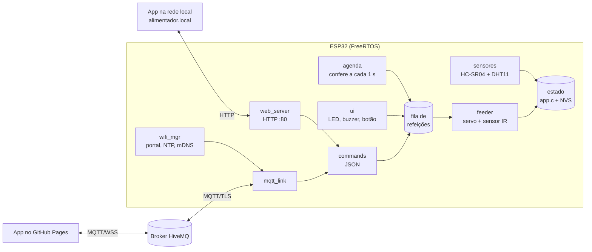

# Firmware (ESP32 + ESP-IDF)

Código que roda na ESP32. Escrito em C sobre o **ESP-IDF 5.3** (FreeRTOS), compilado com **PlatformIO**.

| Placa | Ambiente | Status |
|---|---|---|
| **ESP32-S3-DevKitC-1** (N16R8 ou N8R2), recomendada | `esp32s3` | compila |
| ESP32 clássica (DevKit V1 / ESP32-WROOM-32) | `esp32` | compila |

## Jeito mais fácil: instalar pelo navegador

Abra **[arthurlleite.github.io/Alimentador-Automatico-de-Pets/instalar.html](https://arthurlleite.github.io/Alimentador-Automatico-de-Pets/instalar.html)** no Chrome ou no Edge, ligue a placa no USB e clique em **Instalar**. Os binários são gerados pelo GitHub Actions a cada push.

## Compilar e gravar

1. Instale o [VS Code](https://code.visualstudio.com/) e a extensão **PlatformIO IDE**.
2. Abra **a pasta `firmware/`** no VS Code (não a raiz do repositório).
3. Na barra do PlatformIO, escolha o ambiente (`esp32s3` ou `esp32`) e clique em **Upload**.
4. Abra o **Monitor** (115200 baud) para ver o log.

Pela linha de comando:

```bash
cd firmware
pio run -e esp32s3                 # compila
pio run -e esp32s3 -t upload       # grava
pio device monitor                 # log serial
pio run -e esp32s3 -t menuconfig   # pinos, broker, fuso horário...
```

> A primeira compilação baixa o ESP-IDF e os compiladores (~1,5 GB) e leva alguns minutos.

## Primeiro uso

1. Ligue a placa: o LED pisca **azul** e aparece a rede Wi-Fi **`Alimentador-XXXX`**.
2. Conecte o celular nela. A página de configuração abre sozinha (se não abrir, acesse `http://192.168.4.1`).
3. Informe o nome do pet, escolha o Wi-Fi da casa (2,4 GHz) e a senha.
4. A placa reinicia e conecta. A página mostra o **link pessoal** para controlar de qualquer lugar. Guarde esse link.
5. LED **verde** = online. Na mesma rede, o app também abre em **http://alimentador.local**.

Para trocar de Wi-Fi: segure o botão por **5 segundos** (ou o BOOT da placa), ou use **Ajustes → Esquecer Wi-Fi** no app local.

## Pinos

| Função | ESP32-S3 | ESP32 clássica | Observação |
|---|---|---|---|
| Servo (sinal) | GPIO 4 | GPIO 18 | alimentação do servo vem direto da fonte de 5 V |
| HC-SR04 TRIG | GPIO 5 | GPIO 25 | |
| HC-SR04 ECHO | GPIO 6 | GPIO 34 | **divisor 1 kΩ / 2 kΩ** (o eco sai em 5 V) |
| DHT11 DATA | GPIO 7 | GPIO 4 | módulo com resistor de pull-up |
| Sensor IR da saída | GPIO 9 | GPIO 32 | módulo de obstáculo/bloqueio de luz, saída digital |
| Botão | GPIO 15 | GPIO 27 | entre o pino e o GND |
| Buzzer ativo | GPIO 16 | GPIO 26 | módulo com transistor |
| LED RGB R / G / B | GPIO 17 / 18 / 8 | GPIO 21 / 22 / 23 | resistor de 220 Ω em cada cor |

Todos os pinos, ângulos do servo e tempos são editáveis no `menuconfig` (menus **Alimentador - ...**). O esquema de ligação completo está em [`hardware/eletronica`](../hardware/eletronica/README.md).

## LED de status

| Cor | Significado |
|---|---|
| azul piscando | rede de configuração ativa (sem Wi-Fi salvo, ou não conseguiu conectar) |
| amarelo piscando | conectando ao Wi-Fi |
| ciano | Wi-Fi ok, sem conexão com a nuvem (MQTT) |
| verde | online |
| magenta | servindo ração |
| piscada vermelha | alarme: ração baixa ou o servo girou e nada caiu |

## Arquitetura



| Arquivo | O que faz |
|---|---|
| `main.c` | inicia os módulos |
| `app.c/h` | estado global protegido por mutex, NVS (configuração, Wi-Fi), JSON de status |
| `feeder.c` | fila de refeições, servo por PWM (LEDC 14 bits, 50 Hz), sensor IR com interrupção |
| `scheduler.c` | até 8 horários por dia, cada um com sua porção |
| `sensors.c` | HC-SR04 (mediana de 5 leituras) e DHT11 (protocolo de um fio) |
| `ui.c` | LED RGB, buzzer e botão |
| `commands.c` | comandos JSON, iguais pelo MQTT e pelo HTTP |
| `wifi_mgr.c` | Wi-Fi, portal de configuração, reconexão, SNTP e mDNS |
| `dns_server.c` | DNS do portal cativo (responde tudo com 192.168.4.1) |
| `web_server.c` | servidor HTTP com o app embutido e a API local |
| `mqtt_link.c` | cliente MQTT com TLS, tópicos e testamento online/offline |

### Prioridades das tarefas

| Tarefa | Prioridade | Pilha |
|---|---|---|
| feeder | 6 | 4 KB |
| agenda | 5 | 3 KB |
| ui | 4 | 3 KB |
| sensores | 3 | 3 KB |
| dns (só no portal) | 3 | 3 KB |

## Protocolo

O app manda o mesmo JSON pelo MQTT (`<prefixo>/<código>/cmd`) ou por `POST /api/cmd`:

```json
{"cmd":"feed","portions":2}
{"cmd":"schedule","meals":[{"h":7,"m":30,"p":2,"on":true},{"h":19,"m":0,"p":2,"on":true}]}
{"cmd":"settings","name":"Mel","beep":true,"level_empty_cm":30,"level_full_cm":4}
{"cmd":"status"}
{"cmd":"clear_alarm"}
{"cmd":"time","epoch":1767225600}    // só pela rede local
{"cmd":"wifi_reset"}                 // só pela rede local
```

| Tópico MQTT | Direção | Conteúdo |
|---|---|---|
| `alimentador/<código>/cmd` | app → ESP | comandos acima (com `id` opcional) |
| `alimentador/<código>/state` | ESP → app | estado completo (retido) |
| `alimentador/<código>/event` | ESP → app | `ack`, `fed`, `low_food` |
| `alimentador/<código>/online` | ESP → app | `1` ou `0` (retido, testamento) |

API local: `GET /api/state`, `POST /api/cmd`, `GET /api/scan`, `POST /api/provision`.

## Revisão do código original

O firmware antigo (`lib/my_*`, ainda no histórico do git) tinha a arquitetura certa, mas não rodaria de forma confiável. O que foi encontrado e corrigido:

| Problema no original | Efeito | Correção |
|---|---|---|
| Não compila no ESP-IDF 5 (`.uri` do MQTT, `sntp_*` antigos, `mdns` fora do núcleo) | não gera binário nas versões atuais | APIs do IDF 5.3 e `espressif/mdns` pelo gerenciador de componentes |
| `xQueueFeed` criada com itens de `40*sizeof(int)` e lida para um `int` | cada refeição escrevia 160 bytes numa variável de 4 bytes (pilha corrompida) | fila com `struct` do tamanho certo |
| Ponteiro `event->data` do MQTT enviado para outra tarefa | o buffer é reaproveitado pelo cliente e não termina em `\0` | comando tratado na hora, com tamanho explícito |
| `cJSON_GetObjectItem(...)->valuestring` sem checar nulo | JSON inválido ou campo faltando travava a placa | validação de cada campo |
| `msg = malloc(200)` em todo comando, nunca liberado em alguns caminhos | vazamento de memória | respostas montadas com cJSON e liberadas |
| Agenda vazia → espera negativa; `free()` no ponteiro de `localtime` | refeição disparada errado; corrupção de heap | checagem por minuto, sem cálculo de espera |
| `nvs_flash_init()` chamado em 4 tarefas ao mesmo tempo | condição de corrida na inicialização | uma inicialização em `app_init()` |
| Tarefas com prioridade 0 (igual à tarefa ociosa), pilha de 1 KB no servo | travamentos e estouro de pilha | prioridades 3 a 6 e pilhas de 3 a 4 KB |
| Senha do Wi-Fi impressa na serial; formulário sem limite com `strcpy` em 30 bytes | vazamento da senha; estouro de buffer | log sem senha, `strlcpy` e limite de tamanho |
| Portal de configuração só por 10 min e depois reinício | sem Wi-Fi, ficava reiniciando | portal fica ativo até configurar; reconexão com espera crescente |
| Tópico fixo `exemploMQTT123456` em broker público, sem TLS | qualquer pessoa podia alimentar o pet | código aleatório de 64 bits por placa e MQTT sobre TLS |
| Servo no GPIO 5 (pino de *strapping*) | pode mexer o servo no boot | GPIO 4 (S3) / 18 (clássica) |

## Limitações conhecidas

- O broker público não tem senha: a segurança vem do código secreto no tópico. Para algo além de um protótipo, use um broker com usuário e senha (ex.: HiveMQ Cloud, plano gratuito) e troque `FEEDER_MQTT_URI`.
- Sem bateria de RTC: se faltar energia e a internet não voltar, o relógio só é acertado quando alguém abrir o app local (ele envia a hora do celular).
- Sem atualização OTA nesta versão (a tabela de partições usa um app único de 1,875 MB). Ver próximos passos no README principal.
