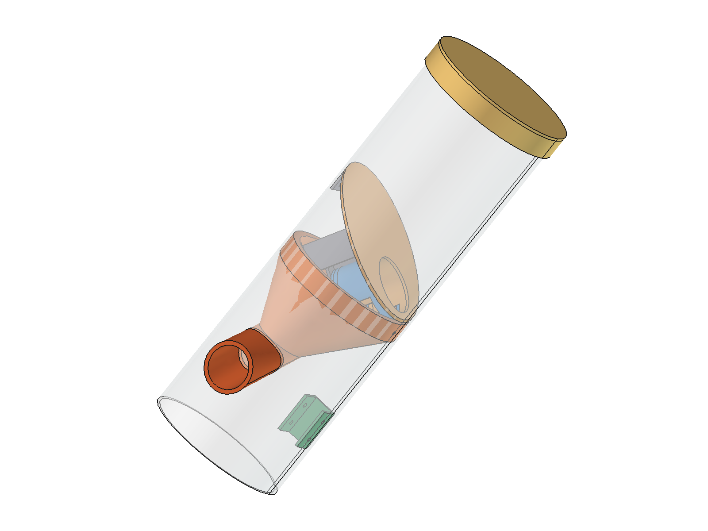
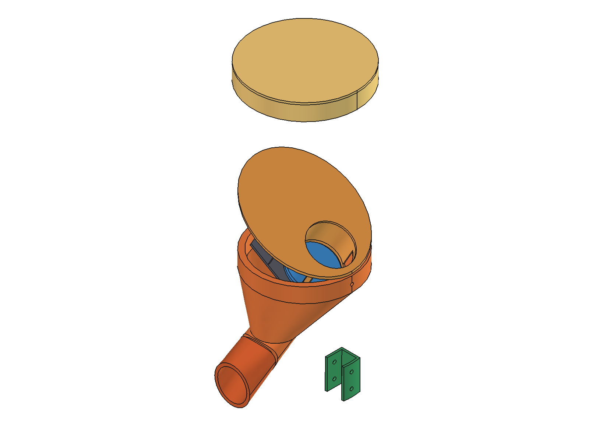
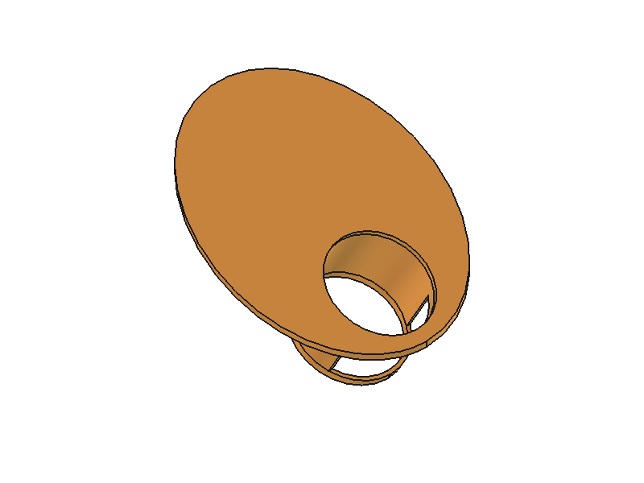
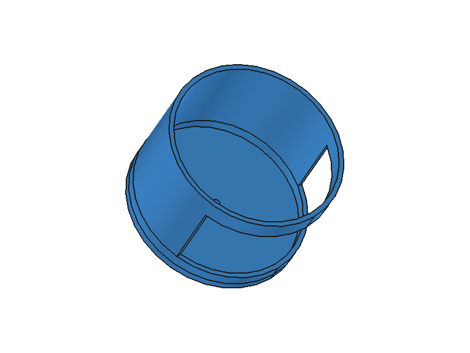
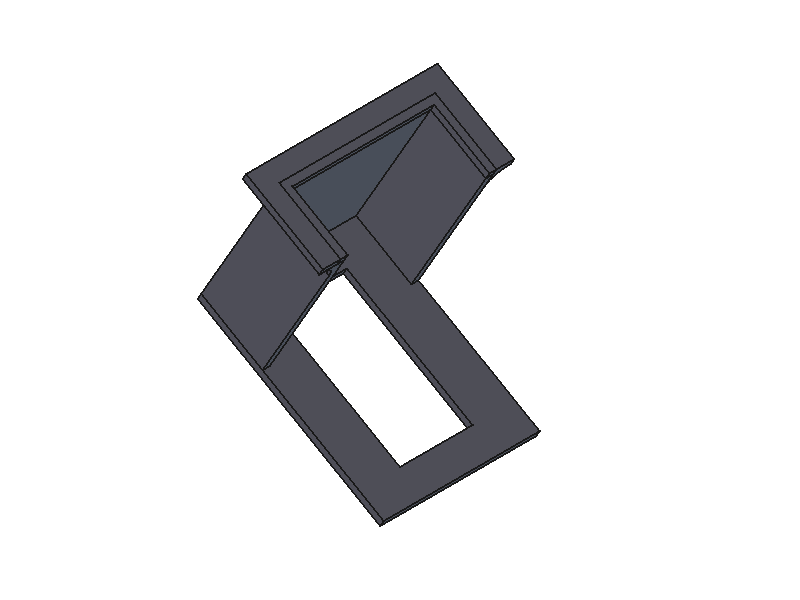
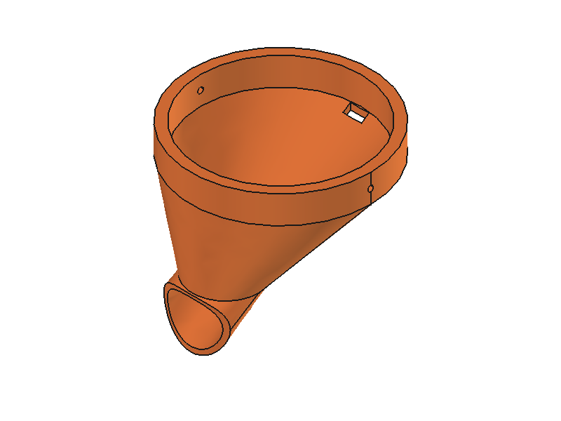
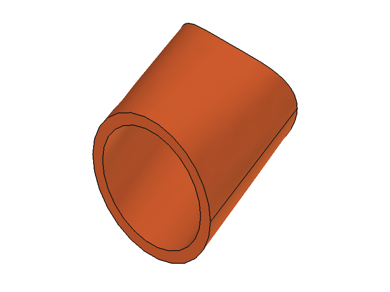
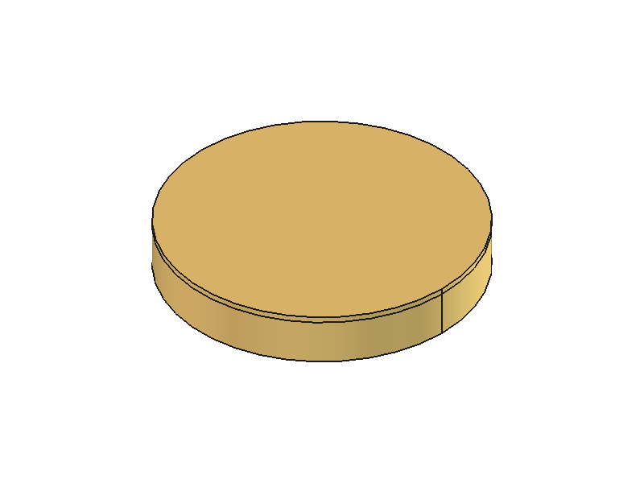
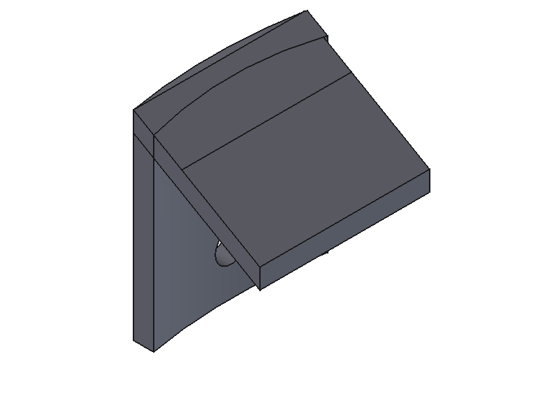
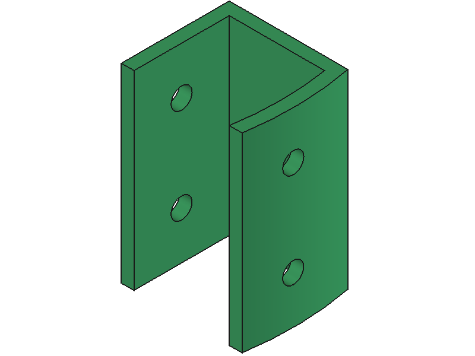

# Peças 3D (para a impressora)

Tudo foi modelado no [FreeCAD](https://www.freecad.org/) (gratuito). O arquivo original é o [`IoT3D.FCStd`](IoT3D.FCStd); as peças prontas para fatiar estão em [`stl/`](stl/).



## Como funciona

A ração fica no tubo de PVC, apoiada na **rampa inclinada**, que tem um furo. Embaixo da rampa, o **servo** (preso no **suporte do motor**) gira a **tampa do atuador**, que tapa e destapa esse furo. Quando abre, a ração escorrega pelo furo, cai no **funil** e sai pela lateral do tubo, pela **extensão do funil**, direto no pote. Cada abertura é uma porção.



## Peças

| Peça | Arquivo | Tamanho (mm) | Volume | O que faz |
|---|---|---|---|---|
|  **Rampa inclinada** | [`rampa_inclinada.stl`](stl/rampa_inclinada.stl) | 97,5 × 97,5 × 80,4 | 18,9 cm³ | Disco inclinado que segura a ração; o furo é a passagem controlada pelo servo |
|  **Tampa do atuador** | [`tampa_atuador.stl`](stl/tampa_atuador.stl) | 54,8 × 46,0 × 49,0 | 6,9 cm³ | Gira com o eixo do servo e abre/fecha o furo da rampa |
|  **Suporte do motor** | [`suporte_motor.stl`](stl/suporte_motor.stl) | 52,5 × 54,0 × 72,1 | 11,9 cm³ | Prende o servo MG996R (54 mm entre as abas) embaixo da rampa |
|  **Funil interno** | [`funil_interno.stl`](stl/funil_interno.stl) | 97,5 × 97,5 × 84,3 | 62,2 cm³ | Recebe a ração e leva até a saída lateral |
|  **Extensão do funil** | [`extensao_funil.stl`](stl/extensao_funil.stl) | 36,0 × 26,5 × 44,9 | 6,7 cm³ | Bico que passa pelo furo do tubo e joga a ração no pote |
|  **Tampa do tubo** | [`tampa_tubo.stl`](stl/tampa_tubo.stl) | 106,5 × 106,5 × 17,0 | 27,7 cm³ | Tampa de cima, por onde se coloca a ração (encaixa por fora do tubo) |
|  **Suporte da rampa** | [`suporte_rampa.stl`](stl/suporte_rampa.stl) | 13,4 × 17,4 × 20,0 | 1,0 cm³ | Calço colado no tubo para apoiar a rampa |
|  **Suporte da placa** | [`suporte_placa.stl`](stl/suporte_placa.stl) | 19,6 × 17,0 × 30,0 | 2,9 cm³ | Prende a placa da eletrônica na parede do tubo |

**Total: ~138 cm³ ≈ 100 a 170 g de filamento**, dependendo do preenchimento.

## O que não é impresso

| Peça | Medida | Onde comprar |
|---|---|---|
| Tubo PVC esgoto 100 mm | **300 mm** de comprimento, Ø externo 101,5 mm | barra de 1 m em loja de material de construção ([Hidrauconex](https://www.hidrauconex.com/tubo-cano-pvc-esgoto-branco-de-100mm-barra-6-metros), [Mercado Livre](https://lista.mercadolivre.com.br/tubo-pvc-100-mm-esgoto)) |
| Cap PVC esgoto 100 mm | fecha a base | [exemplo](https://www.hidrauconex.com/cap-tampao-pvc-esgoto-de-100mm) |
| Servo MG996R | 40,7 × 19,7 × 42,9 mm | ver a [lista de materiais](../../documentacao/materiais.md) |

## Configuração de impressão sugerida

| Parâmetro | Valor |
|---|---|
| Material | **PETG** ou PLA para prototipagem; avaliar material, acabamento e limpeza das superfícies do conjunto que terão contato com ração |
| Camada | 0,2 mm |
| Paredes | 3 perímetros |
| Preenchimento | 20 % (giroide); 40 % no suporte do motor e na tampa do atuador |
| Suporte | só no funil interno e na extensão (ângulos de saída) |
| Orientação | rampa e tampa do tubo com a face grande na mesa; funil com a boca larga para baixo |

Fatiadores gratuitos: [PrusaSlicer](https://www.prusa3d.com/page/prusaslicer_424/), [Cura](https://ultimaker.com/software/ultimaker-cura/) ou [OrcaSlicer](https://github.com/SoftFever/OrcaSlicer).

> **Antes de imprimir tudo**, meça o diâmetro **interno** do seu tubo com um paquímetro. O modelo considera ~97,5 mm (parede de ~2 mm). Se o seu tubo for diferente, ajuste o diâmetro das peças internas no FreeCAD ou escale no fatiador.

## Melhorias em relação à primeira versão

Ideias tiradas da montagem real ([vídeo](https://www.youtube.com/watch?v=HcdWtQP4j1U)):

- **Suporte da rampa integrado**: na primeira montagem o suporte foi impresso à parte e colado. O próximo passo é juntar o [`suporte_rampa`](stl/suporte_rampa.stl) na própria rampa e evitar cola.
- **Agitador**: um parafuso longo preso na tampa do atuador mexe a ração a cada abertura e evita que os grãos "façam ponte" sobre o furo.
- **Furos para os sensores novos**: dois furos de 16 mm na tampa do tubo para o HC-SR04 e um furo lateral na extensão do funil para o sensor IR de saída.
- **Parafusos em vez de cola** sempre que der, para poder desmontar e limpar.

## Gerar as imagens e os STL de novo

Com o FreeCAD instalado, rode na pasta do repositório:

```bash
freecadcmd ferramentas/exportar_3d.py
```

O script ([`ferramentas/exportar_3d.py`](../../ferramentas/exportar_3d.py)) abre o `IoT3D.FCStd` e regrava os STL desta pasta.

