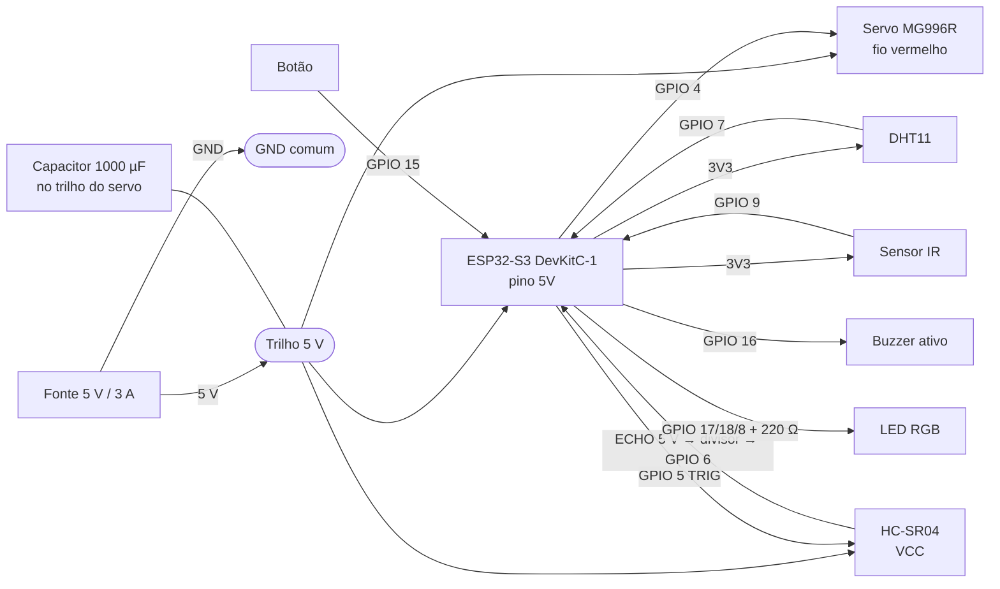

# Eletrônica: ligações

Tudo é alimentado por **uma fonte de 5 V / 3 A**. O servo puxa picos de mais de 1 A ao arrancar, por isso ele **não** pode ser ligado no pino de 5 V que vem do USB do computador.

## Pré-esquemático

[](esquematico.svg)

Versão vetorial: [`esquematico.svg`](esquematico.svg) (abre em qualquer navegador e dá para dar zoom). O desenho é gerado por [`ferramentas/esquematico.py`](../../ferramentas/esquematico.py): para mudar um pino, edite o script e rode `python ferramentas/esquematico.py` na raiz do repositório.

As ligações usam **etiquetas de rede**, como no [KiCad](https://www.kicad.org/): pontos com a mesma etiqueta (`5V`, `GND`, `3V3`, `SERVO`...) estão ligados pelo mesmo fio.

## Diagrama de blocos



## Tabela de ligações (ESP32-S3-DevKitC-1)

| Componente | Pino do componente | Liga em | Observação |
|---|---|---|---|
| **Fonte 5 V** | + | trilho 5 V | |
| | − | trilho GND | GND de tudo junto |
| **ESP32-S3** | 5V (ou 5Vin) | trilho 5 V | |
| | GND | trilho GND | |
| **Servo MG996R** | vermelho | trilho 5 V | |
| | marrom/preto | trilho GND | |
| | laranja/amarelo (sinal) | GPIO 4 | |
| **Capacitor 1000 µF / 10 V** | + / − | 5 V / GND, perto do servo | segura os picos do motor (evita reset da ESP) |
| **HC-SR04** | VCC | trilho 5 V | |
| | GND | GND | |
| | TRIG | GPIO 5 | 3,3 V é suficiente para disparar |
| | ECHO | **resistor 1 kΩ** → GPIO 6, e GPIO 6 → **resistor 2 kΩ** → GND | o eco sai em 5 V; o divisor baixa para 3,3 V |
| **DHT11 (módulo 3 pinos)** | VCC / + | 3V3 | |
| | GND / − | GND | |
| | DATA / S | GPIO 7 | o módulo já tem pull-up |
| **Sensor IR de obstáculo** | VCC | 3V3 | ajuste a sensibilidade no trimpot |
| | GND | GND | |
| | OUT | GPIO 9 | |
| **Botão** | um terminal | GPIO 15 | pull-up interno ligado |
| | outro terminal | GND | |
| **Buzzer ativo (módulo)** | VCC | 3V3 | |
| | GND | GND | |
| | I/O ou S | GPIO 16 | |
| **LED RGB catodo comum** | perna longa (catodo) | GND | se for anodo comum, ligue no 3V3 e ative `ALIM_LED_ANODO_COMUM` |
| | R | **220 Ω** → GPIO 17 | |
| | G | **220 Ω** → GPIO 18 | |
| | B | **220 Ω** → GPIO 8 | |

Na **ESP32 clássica** a ligação é a mesma, só mudam os GPIOs (ver a tabela em [`firmware/README.md`](../../firmware/README.md#pinos)).

## Divisor de tensão do ECHO

```
HC-SR04 ECHO ──[ 1 kΩ ]──┬── GPIO 6
                         │
                      [ 2 kΩ ]
                         │
                        GND
```

5 V × 2 k / (1 k + 2 k) = **3,3 V**. Sem o divisor, o pino da ESP32 pode queimar com o tempo.

## Onde fica cada sensor

- **HC-SR04**: na **tampa de cima**, apontando para baixo, no centro do tubo. Faça dois furos de 16 mm para os "olhos". Ele mede a distância até a ração.
- **DHT11**: dentro do tubo, perto do topo, fora do caminho da ração (umidade alta estraga a ração).
- **Sensor IR**: na **rampa de saída**, de lado, com o LED apontando para onde a ração passa. Cada grão que passa gera um pulso.
- **LED RGB, botão e buzzer**: na frente da caixa da eletrônica, visíveis.

## Montagem da placa

1. Solde a ESP32 em barras de pinos fêmea numa **placa perfurada 5×7 cm**, para poder tirá-la.
2. Faça dois trilhos (5 V e GND) ao longo da placa e solde o capacitor perto do conector do servo.
3. Use barras de pinos macho para servo, sensores e botão. Assim tudo encaixa com jumpers e dá para trocar peças.
4. Entrada da fonte: conector P4 fêmea ou um módulo USB-C só de alimentação.

> **Ao gravar pelo USB**, desligue a fonte de 5 V. Algumas placas não têm diodo entre o USB e o pino de 5 V, e as duas fontes juntas podem aquecer o regulador.
