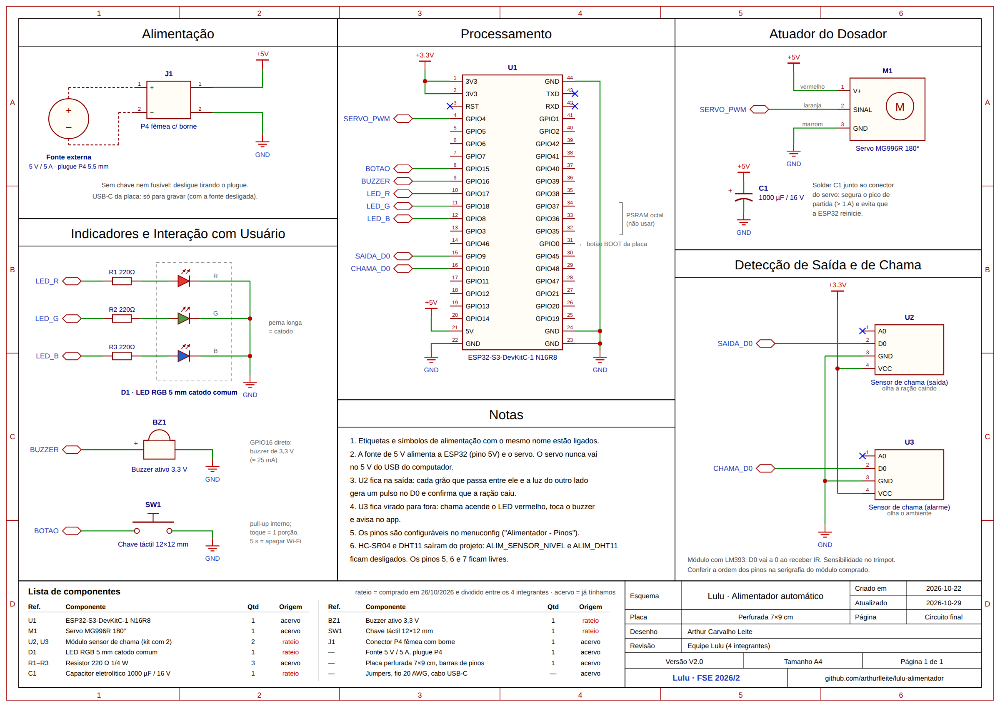
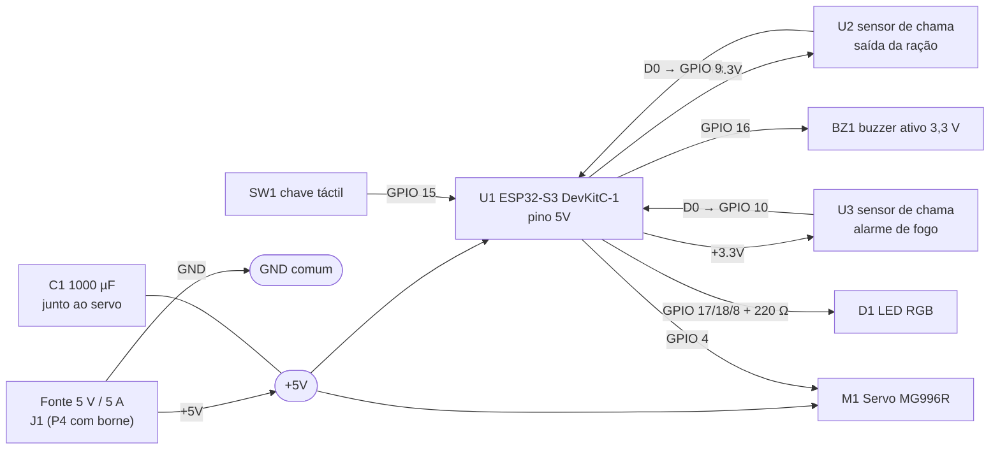

# Eletrônica: esquemático e ligações

Tudo é alimentado por **uma fonte de 5 V / 5 A** (plugue P4). O servo puxa picos de mais de 1 A ao arrancar, por isso ele **não** pode ser ligado no pino de 5 V que vem do USB do computador.

As peças são as que a equipe tem em mãos: ver a [lista de materiais](../../documentacao/materiais.md).

## Esquemático

[](esquematico.svg)

Versão vetorial: [`esquematico.svg`](esquematico.svg) (abre em qualquer navegador e dá para dar zoom). O desenho é gerado por [`ferramentas/esquematico.py`](../../ferramentas/esquematico.py): para mudar um pino, edite o script e rode na raiz do repositório:

```bash
python ferramentas/esquematico.py --png   # --png precisa do Chrome/Chromium e do Pillow
```

A folha segue o padrão do EasyEDA: blocos por função (alimentação, processamento, atuador, sensores, interface), componentes com designador (U1, M1, R1...) e **etiquetas de rede**. Pontos com a mesma etiqueta (`SERVO_PWM`, `LED_R`...) ou o mesmo símbolo de alimentação (`+5V`, `+3.3V`, `GND`) estão ligados pelo mesmo fio.

## Diagrama de blocos



## Tabela de ligações (ESP32-S3-DevKitC-1)

| Ref. | Componente | Pino do componente | Liga em | Observação |
|---|---|---|---|---|
| J1 | **P4 fêmea com borne** | + | +5V | entrada da fonte de 5 V / 5 A |
| | | − | GND | GND de tudo junto |
| U1 | **ESP32-S3** | 5V (pino 21) | +5V | |
| | | GND (22, 23, 24, 44) | GND | |
| | | 3V3 (1, 2) | +3.3V | alimenta os sensores de chama |
| M1 | **Servo MG996R** | vermelho | +5V | |
| | | marrom | GND | |
| | | laranja (sinal) | GPIO 4 | `SERVO_PWM` |
| C1 | **Capacitor 1000 µF / 16 V** | + / − | +5V / GND | soldado junto ao conector do servo |
| U2 | **Sensor de chama (saída)** | VCC | +3.3V | |
| | | GND | GND | |
| | | D0 | GPIO 9 | `SAIDA_D0`; A0 fica sem ligação |
| U3 | **Sensor de chama (alarme)** | VCC | +3.3V | |
| | | GND | GND | |
| | | D0 | GPIO 10 | `CHAMA_D0`; A0 fica sem ligação |
| SW1 | **Chave táctil** | um terminal | GPIO 15 | pull-up interno ligado |
| | | terminal oposto | GND | os 4 pinos são dois pares: use pinos de lados opostos |
| BZ1 | **Buzzer ativo 3,3 V** | + (perna longa) | GPIO 16 | direto no pino, sem transistor |
| | | − | GND | |
| D1 | **LED RGB catodo comum** | perna longa (catodo) | GND | se for anodo comum, ligue no 3V3 e ative `ALIM_LED_ANODO_COMUM` |
| | | R | **R1 220 Ω** → GPIO 17 | |
| | | G | **R2 220 Ω** → GPIO 18 | |
| | | B | **R3 220 Ω** → GPIO 8 | |

Na **ESP32 clássica** a ligação é a mesma, só mudam os GPIOs (ver a tabela em [`firmware/README.md`](../../firmware/README.md#pinos)).

## Os dois sensores de chama

O módulo é um fotodiodo infravermelho (760 – 1100 nm) com um comparador LM393. A saída **D0 vai a 0** quando a luz IR passa do limite ajustado no **trimpot**; o LED do próprio módulo acende junto. A ordem dos pinos muda entre fabricantes (A0/D0/GND/VCC ou VCC/GND/D0/A0): confira a serigrafia antes de soldar.

- **U2, na saída da ração**: fica de um lado da extensão do funil, olhando para a luz que entra pelo outro lado. Cada grão que passa faz sombra e gera um pulso no D0. O firmware conta esses pulsos: se o servo abriu e nada passou, ele sacode, tenta de novo e avisa no app. Ajuste o trimpot com o funil vazio, até o LED do módulo ficar no limite de acender.
- **U3, alarme de fogo**: fica do lado de fora, virado para o ambiente. Se ele vir chama por 1 s seguido, o LED pisca vermelho rápido, o buzzer bipa sem parar e o app mostra "Chama detectada". O alarme some sozinho 5 s depois que a chama sai do alcance. Teste com um isqueiro a uns 30 cm e ajuste o trimpot para não disparar com a luz do sol.

## Buzzer direto no GPIO

O buzzer ativo de 3,3 V puxa cerca de 25 mA. O firmware liga o GPIO 16 com a força máxima de corrente da ESP32-S3 (`GPIO_DRIVE_CAP_3`, até 40 mA), então ele funciona sem transistor. Se o som sair fraco, um transistor NPN (2N2222 ou BC548) com resistor de 1 kΩ na base resolve, mas não faz parte das peças atuais.

## Pinos que não devem ser usados

- **GPIO 35, 36 e 37**: ligados à PSRAM octal da N16R8.
- **GPIO 0**: é o botão BOOT da placa (o firmware usa como segundo botão).
- **GPIO 5, 6 e 7**: estavam reservados para HC-SR04 e DHT11, que saíram do projeto. Estão livres.

## Montagem da placa

1. Solde a ESP32 em barras de pinos fêmea na **placa perfurada 7 × 9 cm**, para poder tirá-la.
2. Faça dois trilhos (+5V e GND) ao longo da placa com o fio de 20 AWG e solde o **C1** perto do conector do servo (atenção à polaridade: a faixa do capacitor é o −).
3. Use barras de pinos macho para o servo, os sensores e o botão. Assim tudo encaixa com jumpers e dá para trocar peças.
4. Entrada da fonte pelo **J1** (P4 fêmea com borne).

> **Ao gravar pelo USB**, desligue a fonte de 5 V. Algumas placas não têm diodo entre o USB e o pino de 5 V, e as duas fontes juntas podem aquecer o regulador.
