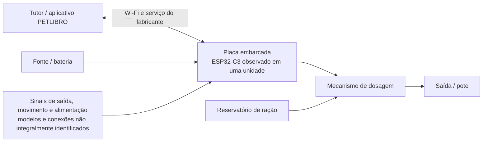

# PETLIBRO Air Smart Feeder (PLAF108)

Estudo de um sistema embarcado comercial e proposta de reprodução parcial com ESP32-S3, denominada **Lulu**. Fundamentos de Sistemas Embarcados — Trabalho 2, 2026/2, FGA/UnB. Entrega prevista no [enunciado da disciplina](https://gitlab.com/fse_fga/trabalhos-2026_2/trabalho-2-2026-2): **03/11/2026**.

## Equipe

| Nome completo | Matrícula | GitLab |
| --- | --- | --- |
| Antônio Lucas De Araújo Lima | 241025597 | [Devv-Antonio1](https://gitlab.com/Devv-Antonio1) |
| Amanda Gonçalves Sobrinho Abreu | 211030925 | [Amandaaaaabreu](https://gitlab.com/Amandaaaaabreu) |
| Carlos Henrique De Paiva Munis | 221022480 | [Depaiiva](https://gitlab.com/Depaiiva) |
| Arthur Carvalho Leite | 222037595 | [arthurlleite](https://gitlab.com/arthurlleite) |

## Navegação do relatório

| Seção do enunciado | Conteúdo |
| --- | --- |
| 3.1 — Descrição do produto | Esta página |
| 3.2 — Características e tecnologias críticas | [Análise técnica](caracteristicas.md) |
| 3.3 — Reprodução com ESP32 | [Proposta, diagramas e limitações](proposta.md) |
| 3.4 — Pesquisa bibliográfica | [Oito artigos: quatro de tecnologias e quatro de aplicação](artigos.md) |
| 3.5 — Produtos similares | [Comparação do PLAF108 com cinco outros produtos](comparativo.md) |
| Referências completas | [Fontes técnicas e bibliográficas](referencias.md) |
| Preparação da entrega | [Checklist, pendências e roteiro de submissão](entrega.md) |

## 3.1 Descrição do produto selecionado

O **PETLIBRO Air Smart Feeder, modelo PLAF108**, é um alimentador doméstico que armazena ração seca e libera porções em horários programados. Destina-se a tutores de gatos e cães pequenos que precisam organizar a rotina de alimentação e acompanhar o dispositivo por aplicativo. Insere-se no segmento de automação doméstica para animais de companhia. [Fonte: fabricante, F1](referencias.md#f1)

*Figura 1 — Imagem promocional fornecida pela PETLIBRO. Fonte e arquivo original: [F1](referencias.md#f1) e [I1](referencias.md#i1). Não é fotografia de um protótipo da equipe.*

O fabricante informa reservatório de **2 L**, programação de **até dez refeições por dia**, **uma a dezesseis porções por refeição**, porção nominal de **10,4 mL** e bateria recarregável de **5200 mAh**. A interface permite programação e consulta de registros pelo aplicativo. Alertas de ração baixa e obstrução ajudam a identificar falhas de abastecimento e dispensação. Volume de porção não equivale a uma massa fixa para qualquer ração. [F1](referencias.md#f1), [F2](referencias.md#f2)

### Construção e controle embarcado

O conjunto combina reservatório, mecanismo rotativo de dosagem, saída de ração, pote, alimentação elétrica e placa de controle. Uma desmontagem publicada pela **Pinecone Data** identifica o módulo **Espressif ESP32-C3-WROOM-02** em uma unidade PLAF108 e documenta acesso à placa. Essa observação se limita à unidade desmontada; revisões do produto podem ter outros componentes. [F3](referencias.md#f3)

*Figura 2 — Placa fotografada na desmontagem da Pinecone Data. Fonte: [F3](referencias.md#f3); imagem original: [I2](referencias.md#i2). A imagem é reproduzida com atribuição para discussão técnica; a equipe não realizou essa desmontagem.*

O controle remoto utiliza Wi-Fi e o aplicativo PETLIBRO. O protocolo de aplicação, a versão do sistema operacional e as proteções do firmware original **não foram identificados com segurança nas fontes consultadas**. A existência de firmware comunitário ESPHome para esse hardware não demonstra que o software original utiliza ESPHome, MQTT ou uma versão específica de FreeRTOS. [F2](referencias.md#f2), [F3](referencias.md#f3)

*Figura 3 — Diagrama conceitual elaborado para este estudo a partir de [F1–F3](referencias.md). Não representa um esquema elétrico levantado pela equipe.*

## Delimitação da reprodução

O **Lulu** reproduz parcialmente agendamento, dispensação e acompanhamento remoto. Usa ESP32-S3, servo, sensor ultrassônico, sensor óptico e DHT11. O [código existente](../firmware/README.md), o [pré-esquemático](../hardware/eletronica/README.md) e o [CAD](../hardware/3d/README.md) fundamentam a proposta. Sua presença no repositório não comprova calibração, integração ou desempenho em bancada. Os ensaios necessários estão na [proposta](proposta.md#plano-de-validacao).

## Método e limites das evidências

Consulta bibliográfica e técnica realizada em **29/10/2026**. Foram priorizados fabricantes, documentação da Espressif, periódicos e os textos originais dos artigos. A desmontagem de terceiro é identificada como observação de uma unidade. Cada característica diferencia **recurso disponível no componente**, **uso observado no produto** e **informação não identificada**.

Os oito artigos foram selecionados como estudos de tecnologias ou aplicações de alimentadores; não são oito avaliações do modelo PLAF108. Os PDFs são apenas vinculados, sem cópias no repositório. A identificação dos quatro integrantes está completa. A revisão do grupo e o procedimento de submissão precisam ser concluídos antes de considerar a entrega encerrada.

