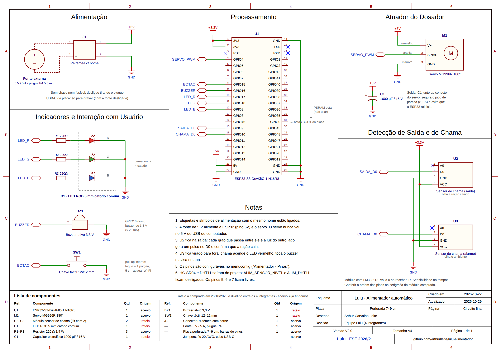
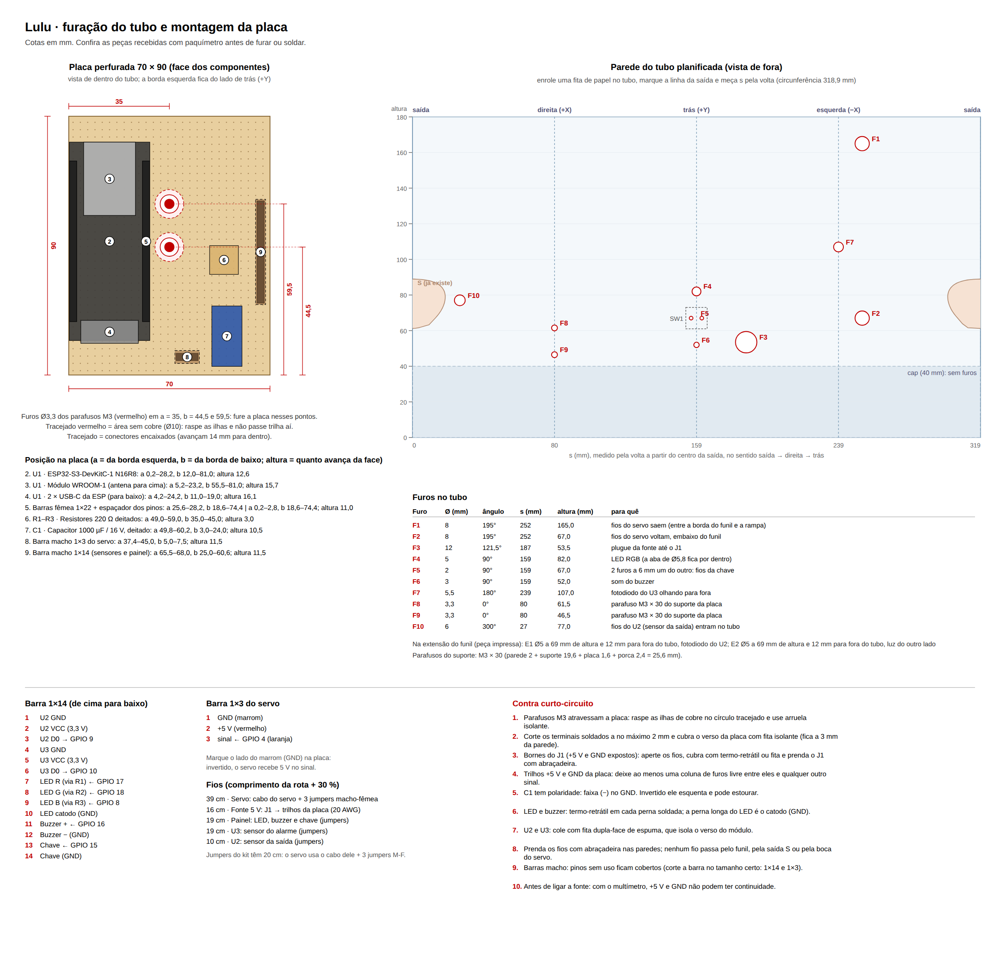
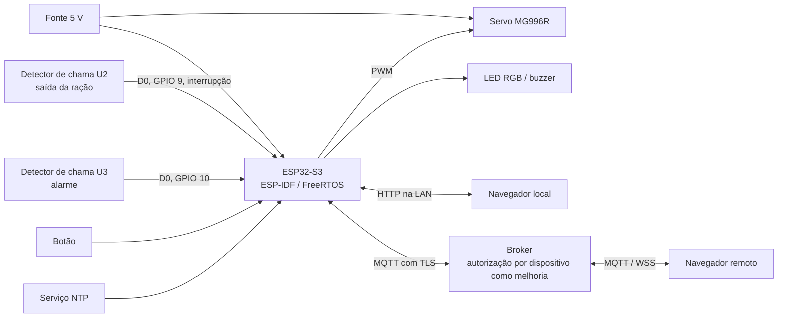
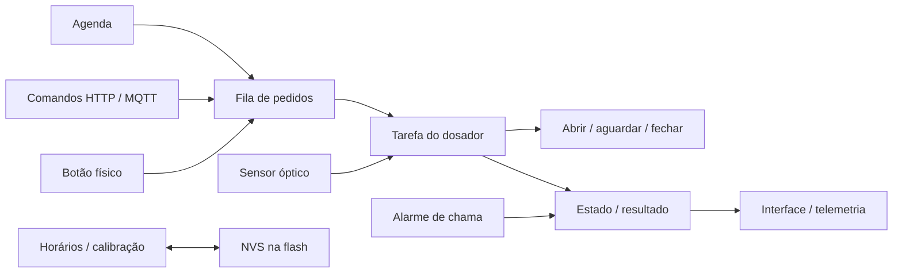

# 3.3 — Proposta de reprodução parcial com ESP32-S3

[Voltar ao relatório](README.md) · [Características do produto](caracteristicas.md) · [Referências](referencias.md)

## Objetivo e estado do desenvolvimento

O **Lulu** propõe reproduzir programação de refeições, acionamento manual, indicação de falhas e acompanhamento remoto. O mecanismo usa um servo que abre uma passagem de ração, em substituição ao dosador comercial. A avaliação deste Trabalho 2 é conceitual; o firmware e o CAD existentes apoiam a proposta, mas não são apresentados como ensaios concluídos.

Há código em [firmware/src](https://gitlab.com/Devv-Antonio1/lulu-alimentador/-/tree/main/firmware/src), interface em [web](https://gitlab.com/Devv-Antonio1/lulu-alimentador/-/tree/main/web), [esquemático](https://gitlab.com/Devv-Antonio1/lulu-alimentador/-/blob/main/hardware/eletronica/README.md), [oito peças STL e um projeto FreeCAD](https://gitlab.com/Devv-Antonio1/lulu-alimentador/-/blob/main/hardware/3d/README.md) e [guia de montagem](https://gitlab.com/Devv-Antonio1/lulu-alimentador/-/blob/main/documentacao/montagem.md), além de [folhas de posicionamento da eletrônica](https://gitlab.com/Devv-Antonio1/lulu-alimentador/-/blob/main/hardware/3d/README.md) com medidas, folgas e furação. Não há nesta revisão comprovação experimental de precisão, autonomia, ausência de travamento ou funcionamento integrado.

## Mapeamento das características

| Grupo da seção 3.2 | Equivalente proposto no Lulu | Implementação / fonte |
| --- | --- | --- |
| 1. Processamento | ESP32-S3, Xtensa LX7 de dois núcleos, até 240 MHz. Recursos ULP/vetoriais disponíveis não são necessários ao escopo atual. | [F8](referencias.md#f8), [main.c](https://gitlab.com/Devv-Antonio1/lulu-alimentador/-/blob/main/firmware/src/main.c) |
| 2. Memória | SRAM interna; configuração em SPI flash via NVS. A placa é descrita como N16R8, mas deve ter marcação/capacidade confirmadas. O build atual configura 4 MB de flash e não demonstra uso da PSRAM. | [F8](referencias.md#f8), [F12](referencias.md#f12), [sdkconfig.defaults](https://gitlab.com/Devv-Antonio1/lulu-alimentador/-/blob/main/firmware/sdkconfig.defaults), [estado.c](https://gitlab.com/Devv-Antonio1/lulu-alimentador/-/blob/main/firmware/src/estado.c) |
| 3. Sistema operacional | ESP-IDF/FreeRTOS, com tarefas para agenda, dosador, interface e sensores. | [F9](referencias.md#f9), [platformio.ini](https://gitlab.com/Devv-Antonio1/lulu-alimentador/-/blob/main/firmware/platformio.ini) |
| 4. Sensores/atuadores | Dois detectores de chama (receptor IR com LM393): um na saída da ração, como barreira óptica que confirma a passagem dos grãos, e outro como alarme de fogo; servo MG996R; LED RGB, buzzer ativo e botão. Todos já adquiridos; a ordem dos pinos dos módulos deve ser conferida na serigrafia. | [Esquemático](https://gitlab.com/Devv-Antonio1/lulu-alimentador/-/blob/main/hardware/eletronica/README.md), [F13](referencias.md#f13), [F14](referencias.md#f14), [F17](referencias.md#f17), [F18](referencias.md#f18) |
| 5. Comunicação com fio | GPIOs e PWM; serial para programação/logs. Não há necessidade funcional de CAN, Ethernet ou RS-485. | [Kconfig](https://gitlab.com/Devv-Antonio1/lulu-alimentador/-/blob/main/firmware/src/Kconfig.projbuild), [dosador.c](https://gitlab.com/Devv-Antonio1/lulu-alimentador/-/blob/main/firmware/src/dosador.c) |
| 6. Comunicação sem fio | Wi-Fi; HTTP local e MQTT/TLS remoto, com WSS no navegador. Bluetooth não integra o fluxo implementado. | [rede_wifi.c](https://gitlab.com/Devv-Antonio1/lulu-alimentador/-/blob/main/firmware/src/rede_wifi.c), [nuvem_mqtt.c](https://gitlab.com/Devv-Antonio1/lulu-alimentador/-/blob/main/firmware/src/nuvem_mqtt.c), [web/index.html](https://gitlab.com/Devv-Antonio1/lulu-alimentador/-/blob/main/web/index.html) |
| 7. I/O | GPIOs para sensores/botão/avisos e LEDC para PWM do servo. ADC/DAC não são necessários aos sensores selecionados. | [sensores.c](https://gitlab.com/Devv-Antonio1/lulu-alimentador/-/blob/main/firmware/src/sensores.c), [dosador.c](https://gitlab.com/Devv-Antonio1/lulu-alimentador/-/blob/main/firmware/src/dosador.c) |
| 8. Energia | Fonte externa de 5 V / 5 A e capacitor de 1000 µF junto ao servo; servo ligado ao trilho da fonte e GND comum. Sem bateria de reserva nesta versão. Watchdog e brown-out constam nos padrões de configuração; sua atuação precisa ser testada. | [Esquema](https://gitlab.com/Devv-Antonio1/lulu-alimentador/-/blob/main/hardware/eletronica/README.md), [sdkconfig.defaults](https://gitlab.com/Devv-Antonio1/lulu-alimentador/-/blob/main/firmware/sdkconfig.defaults) |
| 9. Firmware/OTA | Firmware C; atualização por cabo. Partição factory única: sem esquema OTA no projeto atual. | [partitions.csv](https://gitlab.com/Devv-Antonio1/lulu-alimentador/-/blob/main/firmware/partitions.csv), [firmware/README.md](https://gitlab.com/Devv-Antonio1/lulu-alimentador/-/blob/main/firmware/README.md) |
| 10. Segurança | TLS com verificação de certificados no cliente MQTT. Autorização por dispositivo e proteção contra repetição são melhorias necessárias; Secure Boot/Flash Encryption não são habilitados explicitamente nos padrões versionados. | [nuvem_mqtt.c](https://gitlab.com/Devv-Antonio1/lulu-alimentador/-/blob/main/firmware/src/nuvem_mqtt.c), [sdkconfig.defaults](https://gitlab.com/Devv-Antonio1/lulu-alimentador/-/blob/main/firmware/sdkconfig.defaults), [T4](artigos.md#t4) |
| 11. Armazenamento externo | Sem SD/eMMC no projeto. Configuração em NVS; histórico de dez refeições em RAM, perdido no reinício. | [estado.h](https://gitlab.com/Devv-Antonio1/lulu-alimentador/-/blob/main/firmware/src/estado.h), [estado.c](https://gitlab.com/Devv-Antonio1/lulu-alimentador/-/blob/main/firmware/src/estado.c) |
| 12. Interface | App web local/remoto, portal Wi-Fi, LED RGB, buzzer e botão; aviso de chama no LED, no buzzer e no app. | [web](https://gitlab.com/Devv-Antonio1/lulu-alimentador/-/tree/main/web), [interface.c](https://gitlab.com/Devv-Antonio1/lulu-alimentador/-/blob/main/firmware/src/interface.c) |

## Sensores e atuadores da disciplina

| Componente escolhido | Correspondência na lista da disciplina | Observação |
| --- | --- | --- |
| Detector de chama na saída da ração (U2) | Detector de Chama (Analógico/Digital) | Usado como barreira óptica: o fotodiodo IR olha a luz do outro lado da extensão do funil e cada grão gera um pulso no D0. O Sensor de Bloqueio de Luz da lista é alternativa direta. [F14](referencias.md#f14), [F17](referencias.md#f17) |
| Detector de chama do alarme (U3) | Detector de Chama (Analógico/Digital) | Saída digital (D0) com limiar no trimpot; o firmware exige 1 s contínuo antes de alarmar. Não substitui detector de fumaça certificado. [U6](artigos.md#u6) |
| LED RGB 5 mm catodo comum | Led RGB 5mm | Um resistor de 220 Ω por cor. |
| Buzzer ativo 3,3 V | Buzzer Ativo | Ligado direto no GPIO (~25 mA), com força máxima do pino configurada. |
| Chave táctil | Botão | Pull-up interno; toque = 1 porção, 5 s = apagar Wi-Fi. |
| Servo MG996R | Não consta nominalmente na lista | Aquisição própria (acervo da equipe). [F18](referencias.md#f18) |

O sensor ultrassônico (nível) e o DHT11 (ambiente) constavam da primeira versão da proposta, mas saíram porque não estão entre as peças da equipe. O firmware mantém o código, desligado no `menuconfig`.

Fonte do inventário: [Lista de Sensores e Atuadores Disponíveis, F13](referencias.md#f13).

## Esquemático e montagem

*Figura 4 — Esquemático elaborado pela equipe com as peças adquiridas. Versão vetorial e tabela de ligações no [guia de eletrônica](https://gitlab.com/Devv-Antonio1/lulu-alimentador/-/blob/main/hardware/eletronica/README.md).*

*Figura 5 — Posição da eletrônica dentro do tubo, calculada a partir do modelo FreeCAD: cada componente usa a maior medida publicada entre as variantes e tem folga mínima de 3 mm até o funil, a parede e as outras peças.*

*Figura 6 — Furação do tubo, montagem da placa, mapa de pinos e cuidados contra curto-circuito.*

## Diagramas conceituais

Todos os componentes compartilham a referência de GND conforme o esquemático. O diagrama é funcional; a montagem deve seguir as tensões e ligações do [guia de eletrônica](https://gitlab.com/Devv-Antonio1/lulu-alimentador/-/blob/main/hardware/eletronica/README.md).

## Limitações e desafios

1. **Dosagem por tempo:** uma abertura não garante massa fixa. Tipo de grão, nível, umidade e atrito podem modificar a vazão. O sensor de saída indica passagem, não pesa alimento. Um alimentador com ESP32 e servo chegou a ±2,5 % com calibração ([U5](artigos.md#u5)): serve de meta, não de resultado do Lulu. [U4](artigos.md#u4)
2. **Sem identificação do animal:** não há RFID, pesagem de consumo ou separação entre pets. Dispensar ração não comprova que um animal a consumiu. [U1–U3](artigos.md)
3. **Sem medição de nível:** sem o sensor ultrassônico, o reservatório vazio só é percebido quando o servo abre e o sensor de saída não registra passagem (alarme "nada caiu"). Um sensor de nível pode voltar na versão final.
4. **Sensor de chama como barreira óptica:** o fotodiodo depende de luz infravermelha do outro lado da saída (luz ambiente ou solar). Com pouca luz, a passagem pode não ser vista; com sol direto, o alarme de chama pode disparar sem fogo. Os dois exigem ajuste do trimpot e teste no local de uso; o alarme não substitui um detector de fumaça certificado. [F14](referencias.md#f14), [U6](artigos.md#u6)
5. **Relógio e energia:** após perda de alimentação, a hora precisa ser recuperada por NTP ou pelo navegador local. Sem energia o servo não funciona; sem recuperação da hora a agenda é suspensa pelo código.
6. **Capacidade:** a estimativa de cerca de 1 L útil no tubo atual ainda precisa de medição; a capacidade nominal do PLAF108 não é automaticamente reproduzida aumentando o comprimento externo do tubo.
7. **Ambiente e materiais:** sem sensor de umidade, a conservação da ração depende da tampa e da limpeza. Materiais, acesso para manutenção e isolamento da eletrônica precisam ser avaliados no conjunto construído.
8. **Segurança remota:** o broker público atual e o tópico aleatório não implementam autorização robusta. O TLS custa pouco na ESP32-C3 (latência de 45 para 52 ms, [T6](artigos.md#t6)), mas aumenta energia e variação de latência ([T7](artigos.md#t7)); como o Lulu é ligado na tomada, o custo de energia não é o limitante. O firmware precisa impedir reexecução de comandos repetidos/retidos e restringir a reconfiguração local antes de uso autônomo.
9. **Estado da implementação:** tratar fila cheia na agenda, erros de persistência e validação numérica. Esses pontos são pendências de firmware, não correções comprovadas por este relatório.
10. **Mecânica:** verificar encaixes, movimento completo da boca do servo, fixação do servo e fechamento quando o PWM é desligado. A posição da eletrônica e os furos já estão definidos nas Figuras 5 e 6.

O controle remoto depende do serviço escolhido. O modo HTTP local pode continuar operando sem internet, desde que a rede local esteja disponível; isso não equivale a funcionamento sem energia ou sem relógio válido.

## Plano de validação

Ensaios propostos para o trabalho final; resultados ainda não obtidos. Inicialmente executar em bancada, coletando a ração em recipiente de medição.

| Ensaio | Procedimento proposto | Evidência a registrar |
| --- | --- | --- |
| Compilação | Compilar os ambientes ESP32-S3 e ESP32 definidos no PlatformIO. | Versão do ambiente, commit, log e tamanhos dos binários. |
| Dosagem | Repetir ao menos dez acionamentos por combinação de tipo de ração e nível do reservatório. | Massa individual, média, desvio, mínimo, máximo e referência de calibração. |
| Alarme de chama | Isqueiro a 10, 30 e 50 cm do U3; repetir com sol e lâmpada, sem chama. | Distância máxima detectada, tempo até o aviso no app e alarmes falsos. |
| Saída | Simular passagem normal, ausência de ração, obstrução e sensor desalinhado. | Alarmes, nova tentativa e eventual dispensação extra. |
| Agenda | Testar múltiplos horários, alteração da hora, reinício no minuto de disparo e fila cheia. | Refeições perdidas/duplicadas e política aplicada. |
| Rede | Desligar internet, broker e roteador em cenários distintos. | Operação local, agenda, reconexão e tempo de indisponibilidade. |
| Segurança | Usar broker/dispositivo isolados para repetir IDs, enviar comando retido e tentar acesso não autorizado. | Rejeição e ausência de acionamento extra; não testar outros dispositivos públicos. |
| Persistência | Reiniciar após salvar e testar falhas controladas de gravação. | Agenda, calibração e retorno de erro coerentes. |
| Energia/mecânica | Observar tensão durante acionamento e testar abertura/fechamento com carga. | Quedas de tensão, resets, travamentos, folgas e fixação. |

## Critério de conclusão

Para o Trabalho 2, a conclusão é a documentação fundamentada da proposta e de suas limitações. Para afirmar que o protótipo está validado, será necessário executar os ensaios e acrescentar evidências reais. A consulta bibliográfica não substitui esses testes.

