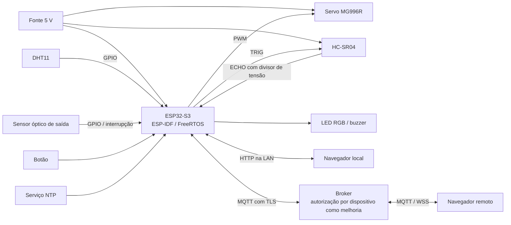
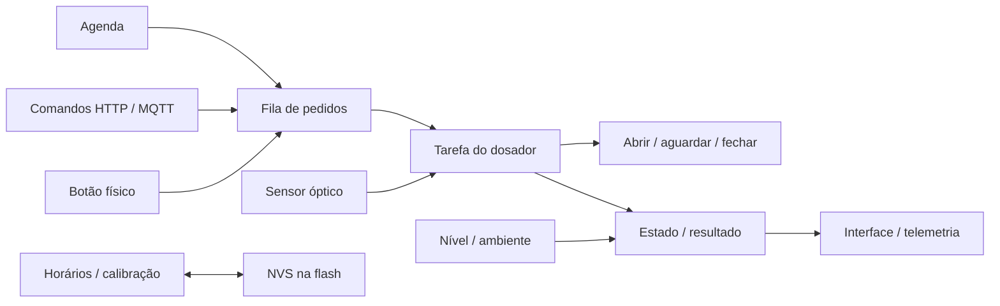

# 3.3 — Proposta de reprodução parcial com ESP32-S3

[Voltar ao relatório](README.md) · [Características do produto](caracteristicas.md) · [Referências](referencias.md)

## Objetivo e estado do desenvolvimento

O **Lulu** propõe reproduzir programação de refeições, acionamento manual, indicação de falhas e acompanhamento remoto. O mecanismo usa um servo que abre uma passagem de ração, em substituição ao dosador comercial. A avaliação deste Trabalho 2 é conceitual; o firmware e o CAD existentes apoiam a proposta, mas não são apresentados como ensaios concluídos.

Há código em [firmware/src](../firmware/src/), interface em [web](../web/), [pré-esquemático](../hardware/eletronica/README.md), [oito peças STL e um projeto FreeCAD](../hardware/3d/README.md) e [guia de montagem](../documentacao/montagem.md). Não há nesta revisão comprovação experimental de precisão, autonomia, ausência de travamento ou funcionamento integrado.

## Mapeamento das características

| Grupo da seção 3.2 | Equivalente proposto no Lulu | Implementação / fonte |
| --- | --- | --- |
| 1. Processamento | ESP32-S3, Xtensa LX7 de dois núcleos, até 240 MHz. Recursos ULP/vetoriais disponíveis não são necessários ao escopo atual. | [F8](referencias.md#f8), [main.c](../firmware/src/main.c) |
| 2. Memória | SRAM interna; configuração em SPI flash via NVS. A placa é descrita como N16R8, mas deve ter marcação/capacidade confirmadas. O build atual configura 4 MB de flash e não demonstra uso da PSRAM. | [F8](referencias.md#f8), [F12](referencias.md#f12), [sdkconfig.defaults](../firmware/sdkconfig.defaults), [estado.c](../firmware/src/estado.c) |
| 3. Sistema operacional | ESP-IDF/FreeRTOS, com tarefas para agenda, dosador, interface e sensores. | [F9](referencias.md#f9), [platformio.ini](../firmware/platformio.ini) |
| 4. Sensores/atuadores | HC-SR04 para distância; DHT11 para ambiente; sensor óptico de saída; servo MG996R; LED, buzzer e botão. Os modelos dos módulos adquiridos precisam ser confirmados. | [Guia de eletrônica](../hardware/eletronica/README.md), [F13](referencias.md#f13), [F14](referencias.md#f14) |
| 5. Comunicação com fio | GPIOs e PWM; serial para programação/logs. Não há necessidade funcional de CAN, Ethernet ou RS-485. | [Kconfig](../firmware/src/Kconfig.projbuild), [dosador.c](../firmware/src/dosador.c) |
| 6. Comunicação sem fio | Wi-Fi; HTTP local e MQTT/TLS remoto, com WSS no navegador. Bluetooth não integra o fluxo implementado. | [rede_wifi.c](../firmware/src/rede_wifi.c), [nuvem_mqtt.c](../firmware/src/nuvem_mqtt.c), [web/index.html](../web/index.html) |
| 7. I/O | GPIOs para sensores/botão/avisos e LEDC para PWM do servo. ADC/DAC não são necessários aos sensores selecionados. | [sensores.c](../firmware/src/sensores.c), [dosador.c](../firmware/src/dosador.c) |
| 8. Energia | Fonte externa de 5 V; servo ligado ao trilho da fonte e GND comum. Sem bateria de reserva nesta versão. Watchdog e brown-out constam nos padrões de configuração; sua atuação precisa ser testada. | [Esquema](../hardware/eletronica/README.md), [sdkconfig.defaults](../firmware/sdkconfig.defaults) |
| 9. Firmware/OTA | Firmware C; atualização por cabo. Partição factory única: sem esquema OTA no projeto atual. | [partitions.csv](../firmware/partitions.csv), [firmware/README.md](../firmware/README.md) |
| 10. Segurança | TLS com verificação de certificados no cliente MQTT. Autorização por dispositivo e proteção contra repetição são melhorias necessárias; Secure Boot/Flash Encryption não são habilitados explicitamente nos padrões versionados. | [nuvem_mqtt.c](../firmware/src/nuvem_mqtt.c), [sdkconfig.defaults](../firmware/sdkconfig.defaults), [T4](artigos.md#t4) |
| 11. Armazenamento externo | Sem SD/eMMC no projeto. Configuração em NVS; histórico de dez refeições em RAM, perdido no reinício. | [estado.h](../firmware/src/estado.h), [estado.c](../firmware/src/estado.c) |
| 12. Interface | App web local/remoto, portal Wi-Fi, LED RGB, buzzer e botão. | [web](../web/), [interface.c](../firmware/src/interface.c) |

## Sensores e atuadores da disciplina

| Componente escolhido | Correspondência na lista da disciplina | Observação |
| --- | --- | --- |
| HC-SR04 | Sensor ultrassom | Verificar modelo disponível e compatibilidade elétrica. |
| DHT11 | Sensor de temperatura e umidade DHT11 | Protocolo proprietário de um fio; não confundir com o barramento Dallas/Maxim 1-Wire. |
| Sensor óptico de saída | Sensor de bloqueio de luz ou detector de obstáculos | Escolher um módulo concreto e definir sua geometria; sensor refletivo e barreira não são mecanicamente intercambiáveis. |
| LED RGB, botão e buzzer ativo | Itens correspondentes listados | Conferir polaridade, corrente e módulo do buzzer. |
| Servo MG996R | Não consta nominalmente na lista consultada | O projeto prevê aquisição própria; confirmar disponibilidade para o trabalho final. |

Fonte do inventário: [Lista de Sensores e Atuadores Disponíveis, F13](referencias.md#f13).

## Diagramas conceituais

Todos os componentes compartilham a referência de GND conforme o pré-esquemático. O diagrama é funcional; a montagem deve seguir as tensões e ligações do [guia de eletrônica](../hardware/eletronica/README.md).

## Limitações e desafios

1. **Dosagem por tempo:** uma abertura não garante massa fixa. Tipo de grão, nível, umidade e atrito podem modificar a vazão. O IR indica passagem, não pesa alimento. [U4](artigos.md#u4)
2. **Sem identificação do animal:** não há RFID, pesagem de consumo ou separação entre pets. Dispensar ração não comprova que um animal a consumiu. [U1–U3](artigos.md)
3. **Nível aproximado:** a conversão linear de distância para porcentagem estima altura entre dois pontos; não mede massa ou volume de um leito irregular. Ecos das paredes e pó exigem testes. [F17](referencias.md#f17)
4. **Relógio e energia:** após perda de alimentação, a hora precisa ser recuperada por NTP ou pelo navegador local. Sem energia o servo não funciona; sem recuperação da hora a agenda é suspensa pelo código.
5. **Capacidade:** a estimativa de cerca de 1 L útil no tubo atual ainda precisa de medição; a capacidade nominal do PLAF108 não é automaticamente reproduzida aumentando o comprimento externo do tubo.
6. **Ambiente e materiais:** o DHT11 não comprova conservação da ração. Materiais, limpeza, acesso para manutenção e isolamento da eletrônica precisam ser avaliados no conjunto construído.
7. **Segurança remota:** o broker público atual e o tópico aleatório não implementam autorização robusta. O firmware precisa impedir reexecução de comandos repetidos/retidos e restringir a reconfiguração local antes de uso autônomo.
8. **Estado da implementação:** tratar fila cheia na agenda, erros de persistência e validação numérica. Esses pontos são pendências de firmware, não correções comprovadas por este relatório.
9. **Mecânica:** incorporar suportes e furos dos sensores; verificar encaixes, movimento completo da tampa, fixação do servo e fechamento quando o PWM é desligado.

O controle remoto depende do serviço escolhido. O modo HTTP local pode continuar operando sem internet, desde que a rede local esteja disponível; isso não equivale a funcionamento sem energia ou sem relógio válido.

## Plano de validação

Ensaios propostos para o trabalho final; resultados ainda não obtidos. Inicialmente executar em bancada, coletando a ração em recipiente de medição.

| Ensaio | Procedimento proposto | Evidência a registrar |
| --- | --- | --- |
| Compilação | Compilar os ambientes ESP32-S3 e ESP32 definidos no PlatformIO. | Versão do ambiente, commit, log e tamanhos dos binários. |
| Dosagem | Repetir ao menos dez acionamentos por combinação de tipo de ração e nível do reservatório. | Massa individual, média, desvio, mínimo, máximo e referência de calibração. |
| Nível | Comparar leitura com distância física em vários enchimentos, incluindo vazio/cheio. | Erro e ocorrência de leitura inválida; posição do sensor e geometria. |
| Saída | Simular passagem normal, ausência de ração, obstrução e sensor desalinhado. | Alarmes, nova tentativa e eventual dispensação extra. |
| Agenda | Testar múltiplos horários, alteração da hora, reinício no minuto de disparo e fila cheia. | Refeições perdidas/duplicadas e política aplicada. |
| Rede | Desligar internet, broker e roteador em cenários distintos. | Operação local, agenda, reconexão e tempo de indisponibilidade. |
| Segurança | Usar broker/dispositivo isolados para repetir IDs, enviar comando retido e tentar acesso não autorizado. | Rejeição e ausência de acionamento extra; não testar outros dispositivos públicos. |
| Persistência | Reiniciar após salvar e testar falhas controladas de gravação. | Agenda, calibração e retorno de erro coerentes. |
| Energia/mecânica | Observar tensão durante acionamento e testar abertura/fechamento com carga. | Quedas de tensão, resets, travamentos, folgas e fixação. |

## Critério de conclusão

Para o Trabalho 2, a conclusão é a documentação fundamentada da proposta e de suas limitações. Para afirmar que o protótipo está validado, será necessário executar os ensaios e acrescentar evidências reais. A consulta bibliográfica não substitui esses testes.

